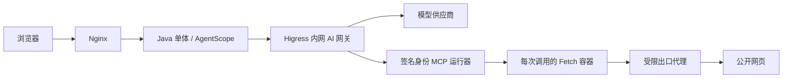

# 单机 AI 网关与隔离 Fetch

本配置用于 `java-cloud` 的同一台 Linux ECS，保留模块化单体。Nginx 处理登录、业务 API 和两套页面；Higress 仅在 Docker 内网接收模型及 MCP 请求。没有新增公网端口，也没有把数据库、检测服务改成微服务。



## 已采用的开源实现

- [AgentScope Java 2.0.4](https://github.com/agentscope-ai/agentscope-java/tree/v2.0.4)，Apache-2.0。使用现有 SDK `streamableHttpTransport` 和 Toolkit 工具发现，保留 `mcp__fetch__fetch` 工具名。
- [Higress standalone 2.2.5](https://github.com/higress-group/higress-standalone)，Apache-2.0。镜像固定 digest，使用无 Kubernetes 模式及镜像内置 `key-auth` 2.0.0。路由遵循[官方重写说明](https://higress.io/en/docs/latest/user/annotation-use-case/)。
- [MCP Python SDK](https://github.com/modelcontextprotocol/python-sdk)，MIT。镜像固定 1.29.0，符合 Fetch 包要求的 `>=1.29.0,<2`。HTTP 调度和 Stdio 握手均走官方协议实现。
- [Fetch](https://pypi.org/project/mcp-server-fetch/2026.10.10/)，MIT。沿用既有固定发布和 SHA-256；所有 wheel、依赖版本、哈希和包内版权文件保存在镜像 `/opt/fetch/`，再以 `--no-index --require-hashes` 安装。
- Squid 采用 Ubuntu 24.04 包，遵循其 GPL 许可；系统包的 `/usr/share/doc` 版权文件保留在镜像内。不把第三方程序改标为本项目许可证。

构建不修改宿主机 Python 环境。模板沿用已存在的 Ubuntu/Temurin 基础镜像，避免再引入无法从 Docker Hub 获取的新 Python 基础镜像。ECS 构建从阿里云 PyPI 镜像下载，固定 Fetch wheel 仍须匹配原 PyPI 发布摘要；安装器仅允许官方索引及该固定镜像，不接受任意索引。构建后的 Fetch 和出口镜像均使用本机不可变 `sha256:…` ID；包更新需重新构建和验收。

## 权限与执行边界

用户仍须登录自己的账号，在 MCP 页面确认固定版本与许可证，安装后主动启用。网关模式在本人 `users/{id}/mcp/fetch/installs/{uuid}` 保存 `gateway-registration.json` 和 `manifest.json`；运行包及完整许可集中保留在经过核对的只读镜像。旧 Stdio 安装或不同镜像的记录需要本人重新确认迁移，不能自动复用。

Java 对用户、运行、启用状态、版本和 URL 的现有检查保留。发往运行器的 HMAC-SHA256 凭证绑定账号 ID、安装 ID、install/execute 范围、随机调用编号和最长 60 秒有效期；模型不能传入身份、命令、镜像或挂载。Higress 对 MCP 路由额外检查服务密钥，运行器再验证签名；不接受浏览器的账号声明代替后端授权。

每次网页调用启动独立非 root 容器：固定 Python 命令，只读文件系统、临时 `/tmp`、去除 capabilities、禁止提权，限制 CPU、内存、PID 和并发。容器没有用户工作区、数据库、OSS、模型密钥或 Docker socket。执行只连接专用 internal 网络，通过 Squid 访问公网 80/443；出口拒绝私网、回环、元数据、特殊地址和 ECS 自身公网 IP，阻断绕开应用层 DNS 检查的直接出口。调用结束、异常和取消会销毁容器，运行器还定期回收超时容器。

**运行器属于受信任基础设施**：只有它挂载 Docker socket 和宿主 Docker CLI。Docker socket 等价于宿主机控制权限，固定命令接口和服务鉴权不能替代虚拟机级隔离。因此当前仅支持已审核的 Fetch，不支持任意 shell、用户 Docker 参数或未审核 Skill 脚本。这不是通用沙箱池。

网关访问日志仅记录路由、状态码、耗时和请求编号；不记录 URL 查询、请求正文、Authorization 或 AI 内容。用户 MCP 操作继续写入既有审计表，关联原 runId/callId；网页地址只记录摘要。

## 服务器首次部署

先备份并核对 V25 表、现有服务和数据卷。从当前代码的服务器副本执行，参数分别是已有私有配置目录和当前成功发布目录：

```bash
# 在 deploy/cloud.env 中设置经核实的 ECS 公网 IP，不能填整个网段
MCP_SERVER_PUBLIC_IPS=101.201.227.35

bash script/shell/provision-ai-gateway.sh \
  /home/ecs-user/doorhandle-release-20261014 \
  "$(cat /home/ecs-user/doorhandle-ci/state/current-directory)"

python3 deploy/mcp/acceptance.py \
  /home/ecs-user/doorhandle-release-20261014/deploy/cloud.env
python3 deploy/mcp/egress-acceptance.py \
  /home/ecs-user/doorhandle-release-20261014/deploy/cloud.env
```

上面的 IP 行是配置内容示例，应写入服务器私有 env 文件。脚本构建两份镜像、生成随机服务密钥和签名密钥，先启动三项新基础服务；不会重启业务后端或替用户启用 MCP。私有配置自动保留一份权限为 0600 的备份，不能加入 Git。验收脚本验证网关鉴权、两个身份的真实 Fetch、内网拒绝、取消后凭证拒绝及容器清理，不调用收费生成模型。

通过后创建显式发布标记，再由本机 Jenkins 发布：

```bash
touch /home/ecs-user/doorhandle-release-20261014/deploy/ai-gateway.enabled
```

`deploy-remote.sh` 在标记和本次源码的 `compose.ai-gateway.yml` 同时存在时合并 overlay。应用发布仍只替换 backend/nginx；网关、运行器和出口镜像单独按本节升级。没有 overlay 的旧成功发布仍按原直连方式回滚，不自动删除网关资源。

Higress DNS 注册使用带点的 `mcp-runner.ai.internal` 网络别名，standalone 的插件规则按 Ingress 名 `mcp-fetch` 匹配；不能直接照搬另一种部署模式的命名。镜像构建关闭随机 attestation，保留 `pin-<digest>` 标签，避免 Docker/containerd 在移动唯一标签后无法再按旧裸 ID 查找镜像。旧 pin 标签供回退使用，不能在仍有注册或容器引用时清理。

模型工厂通过 `AGENT_MODEL_GATEWAY_BASE_URL=http://higress:8080` 接入，保留原供应商 API 路径、Bearer 和 Responses 附加头。余额不足、首响应超时、故障切换及熔断继续由现有模型管理执行，不再叠加网关重试。配置生成器只读取上游地址和 MCP 服务密钥，不把供应商密钥写入网关资源。

## 尚未覆盖

当前只桥接固定 Fetch 的 Stdio→Streamable HTTP；外部 HTTP/SSE 服务的通用注册、任意 MCP 安装、Skill 脚本执行、工作区挂载与配额、多实例任务调度、容器逃逸防护和完整对抗评测仍需开发。停机后 Docker 重启会恢复常驻服务；临时 Fetch 容器无重启策略，由运行器回收。

## 2026-10-15 服务器验收

应用发布为 Jenkins `doorhandle-java` **#11 SUCCESS**，分支 `java-cloud`，代码 `746ff5e2fc98bcfcb261478576d7ed54a583920a`，当前目录 `/home/ecs-user/doorhandle-ci/releases/ci-11-746ff5e2fc98`。JUnit 汇总 565 项：542 通过、23 个可选检查跳过、0 失败；主站 54 项与独立 Agent UI 5 项 Node 测试、双前端生产构建通过。实际部署前另完成两个身份的原生 MCP 抓取和容器边界测试。

| 检查 | 结果 |
| --- | --- |
| MCP 服务密钥、签名及 scope | 缺少服务密钥、签名被篡改及不适用范围被拒绝 |
| 两个独立身份调用 | `100001`、`100002` 均通过实际隔离 Fetch 读取公开页面；属于基础设施测试身份，不替实际用户创建启用配置 |
| 运行中的调用取消 | 实际观察运行容器后取消，工具返回错误，容器销毁；非 root、只读、无业务挂载与密钥、PID/内存限制通过检查 |
| 网络出口 | 公开页面经代理成功；元数据、回环、私网、解析为回环的域名及 ECS 公网 IP 均被拒绝；直接公网连接失败 |
| 主站人工确认及账号隔离 | 测试员工确认迁移后完成实际 SDK 握手；缺少许可确认返回 400，另一账号未安装时探测返回 403 |
| 真实 Agent 端到端 | 新建会话 `sess_inspector.demo_de6bca70`，经真实模型、原生 Java MCP、Higress 和隔离容器抓取，回答包含 `Example Domain`；运行 `cee88113-5db3-469a-927d-a81262fca524` 完成并保存 CALL 审计 |
| 回归与数据保留 | 四个演示账号查询通过，原批次仍为 100 成功 / 0 失败，11 项常驻服务健康，临时容器剩余 0 |

测试员工 `inspector.demo` 保留网关模式安装，**保持停用**；其他三个演示账号保持未安装。进入“Agent智能系统 → MCP工具”可自行测试连接，再确认启用。

同时修复了真实部署暴露的运行租约问题：JDBC 连接时区与 JVM/数据库时区不一致时，`Timestamp.toLocalDateTime()` 曾使新租约比数据库当前时间早 8 小时，MCP 因而被运行授权拒绝。日志、租约和运行时间现以 JDBC `LocalDateTime` 读取数据库的原始时间，不改历史记录；回归测试覆盖旧 Timestamp 读取发生 8 小时偏移的情形。真实完成运行的起止租约间隔已核实为 90 秒。

模型网关转发及备用 DeepSeek 已实际响应。北京网络中默认灵算上游仍出现连接失败，现有模型管理自动切换到 DeepSeek；引入 Higress 并未解决该外部供应商的网络可达性。Mem0/Embedding 的独立供应商连接也不属于这次 AgentScope 模型工厂接入范围。通用模型凭证托管、网关 Token 配额及完整可观测性继续按后续任务推进。

基础设施最终运行镜像为 `sha256:dd4ba96542f92d0dddd5772f706b96717fccd84110f40289b334dfc06da18f54`；部署修订补充了 init/运行器变更时的网关及出口重启依赖，并通过真实服务器 Compose 校验。基础设施验收脚本独立执行，不会因普通应用发布而自动调用公网或生成模型。

证据在服务器 `/home/ecs-user/doorhandle-ci/state/`：`gateway-acceptance.log`、`gateway-egress-acceptance.log`、`gateway-app-acceptance.json`、`gateway-chat-trace.json`、`gateway-final-verification.json` 和 `gateway-lease-check.log`。本机保存 Jenkins 归档于 `work/jenkins/build-11-artifacts/`；这些运行证据和私有配置均不加入 Git。
