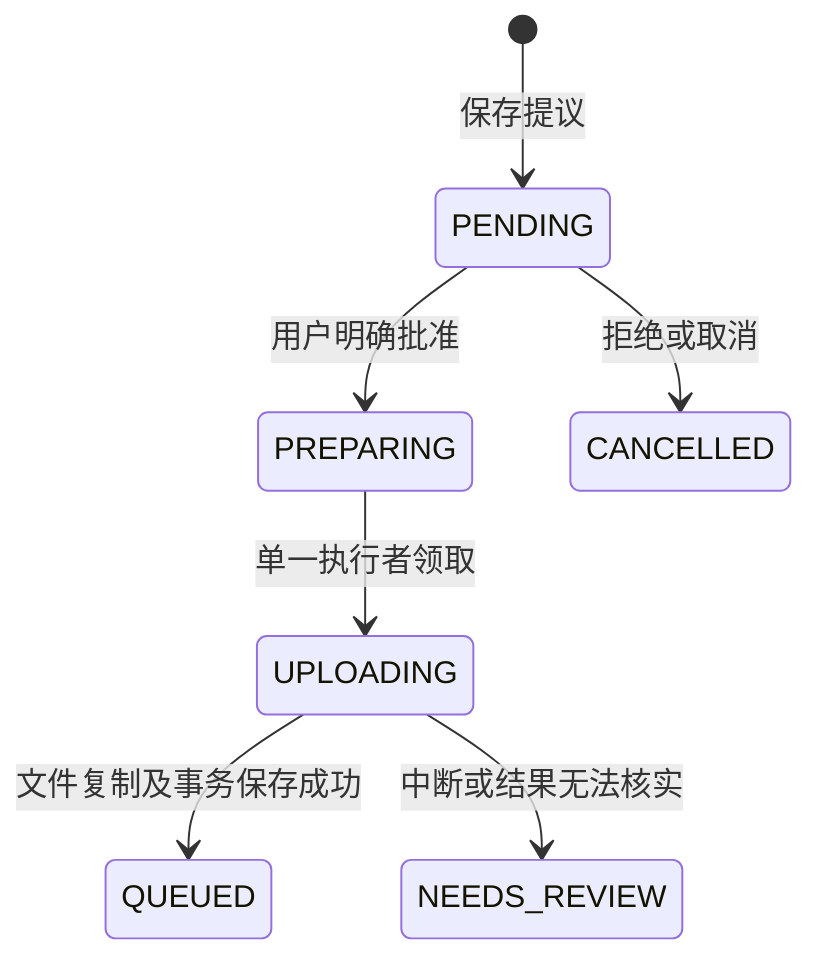

# Agent 会话图片创建检测

更新日期：2026-10-22（UTC+8）。分支：`java-cloud`。

**本轮按用户要求优先开发功能，没有运行测试、构建或数据库迁移，也没有部署 ECS。下述内容描述新增代码，不代表验收通过。**

## 用户流程

1. 用户通过聊天输入区的加号上传 JPEG/PNG，或将有权访问的检测任务关联到当前会话；工具以会话文件编号或 `{taskId,fileId}` 业务原图引用选择输入。
2. 主 Agent 将明确的创建检测要求交给当前角色的检测专业 Agent，调用 `propose_detection_creation`。
3. 缺少采集日期、区域、采集人、设备或批次文件夹时，工具返回缺失字段，提示 Agent 使用已有 `ask_user_question` 补齐；无提问工具时先在聊天追问。工具不会使用“未知设备”等占位值代替用户信息。
4. 服务端核对会话归属、文件编号、内容摘要、图片格式、数量/大小、已发布检测模型和阈值。提议保存后，Vue/React 卡片展示图片、采集信息、模型版本和阈值。
5. 用户明确点击“确认创建检测”，服务端再次核对已保存参数、资源版本和权限，保存批准及创建命令。普通回答或计划批准不能代替该确认。
6. 后台复制已批准的图片到固定业务目录；成功后在同一数据库事务中保存检测任务、稳定身份关联（启用时）、检测模型使用记录、命令回执、必要审计及 Kafka 事务消息。
7. 卡片经刷新核对显示“已提交检测”，CPU PTH worker 按现有事件链路处理。准备中的创建命令也接入工作台任务中心，不占用 Agent 等待执行槽。

员工通过 `detection-task`、主管通过 `detection-quality` 获得该受确认工具。它与主管质检分派保持不同操作类型，不能自动复核、放行或审批报告。检测模型与聊天 LLM 选择分别管理。

## 参数变更与幂等

- 提议固化图片元数据、SHA-256、采集信息、检测模型元数据版本及阈值。
- 同一次运行中，相同图片与参数复用原提议；共享图片的待确认旧提议被新参数替代。
- 修改为完全不同的图片时，可使用 `replacesActionId` 指定本人当前运行的待确认旧提议，使其失效。互不重叠的批次可保留各自提议。
- 确认接口只接收决策和版本，不接收浏览器重新提交的业务参数。确认动作编号绑定业务请求编号，重复确认不再创建命令。
- 每个账号最多保留 16 个准备中、传输中或待核对的创建命令；未核对命令不提前释放额度。

## 后台状态与不确定结果

`PREPARING`/`UPLOADING` 在确认卡片上显示准备中，`QUEUED` 才表示已受理检测派发，不代表模型推理完成。

领取命令前保存持久执行令牌和期限；OSS 网络传输在批准事务之外进行。已开始传输的命令在重启、超时或提交结果未知时进入待核对，不按租约过期自动重传。已提交的成功状态不会被迟到错误覆盖。

账号角色、会话资料或模型版本发生变化时停止继续派发，保留已上传对象和命令。新增本人待核对面板及只读核对、确认完成原创建、终止创建操作，详见 [传输回执与人工核对](检测创建传输回执与人工核对.md)。这些是尚未编译或验证的新代码，不代表链路已通过验收；不会通过核对重传图片、删除未知对象或生成第二个派发编号。

## 文件与模块边界

- `contracts`：`WorkspaceDetectionImagesApi`、`DetectionCreationApi`、`DetectionModelSelectionApi`。
- App：私有会话文件鉴权、图片校验、受控预览及任务中心适配。
- AI：角色工具、提议持久化、人工确认、状态核对、SDK 中断后原提议查询。
- 检测：创建命令登记、执行领取、文件复制、任务/事件/回执/审计事务。
- 模型：已发布检测模型选择、版本复核及使用记录更新，不向浏览器返回模型路径。

浏览器和模型只能提供文件编号，不接收本地路径或任意 OSS 地址。创建图片预览使用按账号和会话重新鉴权的固定接口，HTML/SVG 不通过该接口执行。

重试卡片也增加原图预览，复用检测模块授权读取；最多展示前 20 张，超过时明确说明预览范围，不把标注图当作本次输入原图。

当前创建代码支持私有工作区及当前会话已关联检测任务中的 JPEG/PNG 原图。业务引用先按检测任务权限解析，提议阶段读取真实内容计算 SHA-256；批准事务只核对元数据与权限，执行前再核对实际字节。标注图不作为原图输入，模型不能提交本地路径或任意 OSS 地址。WebP 不自动转码，BMP 尚未接入工作区上传。文件大小和账号总存储继续使用现有配额，检测默认单图限制为 10 MiB、单批最多 200 张，最终以部署配置为准。

创建提议策略升级为 `detection-creation-confirmation-v2`，旧版尚未批准的提议须重新生成。已批准的旧私有图片命令保留原六字段资源摘要，不因新增来源字段失效。旧 `PREPARING` 命令可在首次领取前补齐固定目标清单；已经进入未知状态但没有清单的命令不推测原路径，仅允许终止并保留证据。

## 迁移、配置与后续工作

新增 `migration-V43-detection-creation.sql`、V50 固定传输清单/回执、V51 人工核对记录，根 SQL 和检测模块 classpath 均提供副本。`DETECTION_AGENT_CREATION_ENABLED`、`DETECTION_AGENT_BUSINESS_IMAGES_ENABLED`、`DETECTION_CREATION_TRANSFER_EVIDENCE_ENABLED`、`DETECTION_CREATION_REVIEW_ENABLED` 默认关闭；业务原图及核对开关依赖传输证据开关。需要 V19、V42、V43、V50/V51（按开关）、人工确认、工作台文件、业务审计及检测事务消息；不能只启用后端而关闭 worker 持久回执。

后续继续完成上下文、Skill/MCP 生命周期、身份及审计覆盖、模型治理交付等原计划。2026-10-21 编译记录仅对应当时私有图片创建代码；2026-10-22 业务原图、传输证据及人工核对改动按最新要求未编译、测试、迁移或部署。专项、真实业务联调及最终统一验收尚未完成，历史局部成绩不能替代本链路。最后经 Jenkins 统一发布，微服务在单体完成后另建分支。
