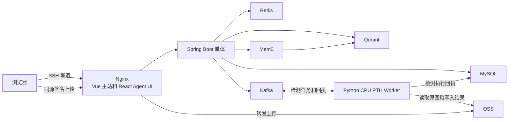

# 服务器单机 Docker 部署方案

当前单体在用户自己的 Ubuntu 上直接开发和部署，复用服务器已有的 Docker Engine 和 Compose 插件。一套 Compose 项目运行一个 Spring Boot 模块化单体、一个托管两套前端的 Nginx，以及独立的中间件和检测 Worker。数据先在专属 MySQL 实例内恢复和迁移，步骤见 [个人 Ubuntu 隔离迁移](../database/compact-migration-orchestration.md#个人-ubuntu-上的隔离迁移)。

## 运行拓扑



| 编排 | 容器和用途 |
| --- | --- |
| [compose.monolith.yml](../../compose.monolith.yml) | `backend` 运行一个 Java 进程。`nginx` 托管 Vue 主站和 React Agent UI，并代理 `/api/`、`/agui/` 和 OSS 上传。 |
| [compose.cloud.yml](../../deploy/compose/compose.cloud.yml) | `mysql` 保存业务记录，`redis` 提供缓存与协调，`kafka` 用单节点 KRaft 传递检测和报告事件。`mem0` 保存记忆服务状态，`qdrant` 保存向量。 |
| [compose.detection.yml](../../deploy/compose/compose.detection.yml) | `detection-worker` 消费 Kafka 并执行 CPU PTH 推理。写入执行回执需按验收配置启用，并使用目标库的独立 Worker 账号。 |

三份 Compose 合计八个常驻容器。`kafka-storage-init`、`kafka-init` 和 `qdrant-storage-init` 等待对应依赖或准备数据卷，成功后退出。纳入 AI/MCP 验收时叠加 [网关配置](../../deploy/compose/compose.ai-gateway.yml)，并核对固定命名的 MCP 网络、受限出口和 Runner 的 Docker socket 权限。观测和模型密钥配置按同一候选批准的功能启用，沿用 [观测配置](../../deploy/compose/compose.observability.monolith.yml) 和受保护的 [模型配置](../../deploy/compose/compose.model-config.yml)。

## 部署目录、端口和资源

个人服务器使用两个回环入口。8080 是 `java-cloud`，在主站私有运行文件中设置 `NGINX_BIND_ADDRESS=127.0.0.1` 和 `NGINX_PORT=8080`。8081 是当前任务分支，使用独立项目名、MySQL 实例、Redis、Kafka、Qdrant、Mem0、检测 Worker、后端和前端。在根编排、cloud 和 detection 编排之后叠加 `deploy/compose/compose.local-review.yml`。评审运行文件保存固定镜像 ID、独立凭据和模型只读目录。评审数据卷在重启后保留。

8081 的侧边助手和独立对话页共用会话附件。评审环境文件中的 `AGENT_WORKBENCH_ENABLED`、`AGENT_WORKBENCH_FILES`、`AGENT_CONVERSATION_CONTROL_ENABLED` 和 `AGENT_RUN_JOURNAL_ENABLED` 均应为 `true`。文件内容保存在评审工作区数据卷，会话归属和文件引用保存在评审 MySQL。登录后从输入框的「添加附件」上传文件即可核对。

首次启动评审时，先单独启动评审 MySQL，恢复业务快照并仅在该实例执行分支迁移，读回表结构后再启动其余服务。后续使用该分支的同一组 Compose 文件和环境文件执行 `up -d --no-build --pull never`。业务服务位于评审内部网络；外部模型和对象存储需要另行配置评审专用凭据及出口。浏览器可用 `http://localhost:8080/` 登录主站，用 `http://127.0.0.1:8081/` 登录评审，两个主机名分别保存登录 Cookie。在 Windows 使用这些地址需要先建立相应的已授权 SSH 转发。

以下以 [实验室 Ubuntu 项目根目录](配置方案.md#3-账号权限与目录先确认再配置) 为例。已有正式运行目录继续以其发布回执为准。

| 用途 | 目录 | Compose 项目与访问 |
| --- | --- | --- |
| 长期运行 | `runtime/`，保留固定版本目录与发布状态 | 实验室新环境建议使用固定项目名 `doorhandle-monolith`。Nginx 默认绑定 `127.0.0.1:8088`。 |
| 隔离候选 | `ci/<运行编号>/`，每轮独立 | 示例 `doorhandle-ci-123`。Nginx 使用当轮核定的空闲回环端口，例如 `18089`。实际完整验收的临时 MySQL、端口和连接覆盖由受控入口管理。 |
| 运行输入 | `private/`、`models/` | 分环境保存私有配置、Secret 和只读检测模型。 |
| 恢复和取证 | `backups/`、`evidence/` | 保存快照、迁移证明、原始报告和发布回执。 |

同一长期环境更新时保持项目名和数据卷稳定。隔离候选使用不同项目名、卷、网络、私有挂载、账号及 OSS 对象前缀。Compose 项目名能隔离默认命名资源，显式命名的网络、外部卷和宿主机绑定路径需要单独核对。中间件通过 `mysql`、`redis`、`kafka` 等容器 DNS 名在项目网络通信。项目 Redis 不映射宿主机端口，实验室已有的 `6379` 可继续由原 Redis 使用。 [Docker Compose 项目命名](https://docs.docker.com/compose/how-tos/project-name/)

准入时通过已核验的 SSH 通道确认主机身份、授权 Docker 执行账号、CPU 架构、回环端口及现有容器。分别核对项目盘与 `docker info` 所示 Docker Root Dir 所在分区，给镜像、构建缓存、迁移暂存及备份留空间。基础完整栈已声明的容器内存上限合计约 12.5 GiB，包含 2 GiB 的 Worker，Worker 默认限 2 CPU。容量以实际并发和磁盘峰值评估，另计宿主机、Nginx、构建及可选服务。

## 发布输入与配置

| 输入 | 准备要求 |
| --- | --- |
| 固定版本和镜像 | 在本机构建单体，验收与部署使用同一固定源码和制品。记录源码、JAR、应用镜像和中间件镜像实际 ID 或 digest。网络受限时可导入有摘要证明的镜像归档，导入后核对 ID。 |
| Compose 与私有配置 | 从 `deploy/cloud.env.example` 准备服务器私有文件，权限 `0600`。`--env-file` 用于 Compose 插值，`DOORHANDLE_ENV_FILE` 指定传给后端容器的宿主机文件。Java 容器内如启用 `DOORHANDLE_JAVA_ENV_FILE`，使用容器可见路径。私有文件、密钥和原始数据不进入 Git、构建上下文或普通 Jenkins 制品。 |
| MySQL、Redis 和 Kafka | Compose 能准备 MySQL 实例，业务表和授权由 [29 表部署协议](../database/compact-deployment.md) 管理。迁移账号与 app、worker 运行账号分离，正式目标使用迁移产生并绑定摘要的连接覆盖配置。Redis 使用项目专属密码和 AOF 卷，Kafka 使用现有初始化脚本创建主题。 |
| Qdrant 和 Mem0 | `QDRANT_IMAGE` 使用已准入的本地不可变镜像 ID。本机覆盖从 `QDRANT_PRIVATE_DIR` 读取只读 `server.yaml` 和 `api-key`。预建 `OBSERVABILITY_SECRETS_DIR`，关闭观测时可为空。Mem0 与后端使用一致的桥接凭据，并按这一轮输入配置 LLM、Embedding 及向量集合。 |
| 检测与 OSS | `DETECTION_MODELS_DIR` 预建并只读挂载，包含已校验的 PTH 权重与匹配的 `manifest.json`。环境中的 `DETECTION_MODEL_ID` 对应该目标库已登记且发布的模型。核对模型目录的实际组权限、Worker 构建输入和 OSS 读写范围。`OSS_UPLOAD_HOST` 使用后端配置的桶域名。 |

### 接入已迁移的本机 MySQL

在三份基础配置之后叠加 [本机覆盖](../../deploy/compose/compose.local.yml)。把隔离迁移 `owner.json` 中的网络、MySQL 容器名和实际端口分别填入 `LOCAL_MYSQL_NETWORK`、`LOCAL_MYSQL_HOST`、`LOCAL_MYSQL_PORT`，并确认对应容器正在运行。业务库名称取最终读回回执的 `targetSchema`。`DB_URL`、`DB_USERNAME`、`DB_PASSWORD` 指向该库的应用账号，`MYSQL_DATABASE` 填同一个目标库名，`LOCAL_MYSQL_WORKER_USER` 和 `LOCAL_MYSQL_WORKER_PASSWORD` 使用单独的 Worker 账号。两个账号只授目标库的读写权限。默认启动复用已验证的 MySQL，项目内由 `managed-mysql` profile 控制的初始化实例保持关闭。

把实际的本机镜像 ID 填入 `LOCAL_BACKEND_IMAGE`、`LOCAL_WEB_IMAGE`、`LOCAL_WORKER_IMAGE`、`LOCAL_MEM0_IMAGE`、`LOCAL_REDIS_IMAGE`、`LOCAL_KAFKA_IMAGE` 和 `QDRANT_IMAGE`。运行阶段使用 `up -d --no-build --pull never`。开放 Nginx 前确认 OSS 原图可读、检测模型与 Worker 编号一致，以及 Mem0 和 Embedding 使用的真实凭据有效。启动和停机只针对该 Compose 项目；迁移 MySQL 的备份、恢复和进程状态独立管理。

容器需借助宿主机 HTTP 代理访问 OSS 时，在本机覆盖后叠加 [OSS 通道](../../deploy/compose/compose.local-oss.yml)。`OSS_LOCAL_PROXY_HOST` 和 `OSS_LOCAL_PROXY_PORT` 指向只供该项目网桥访问的代理地址。通道仅转发 `OSS_UPLOAD_HOST` 的 TLS 连接，保留客户端对桶域名和证书的校验。

## 部署和验收顺序

1. 整合应用、配置、迁移、夹具、取消与恢复流程，再做跳测试构建。提交推送前核对 SCM 触发规则，固定提交后只安排一轮统一验收。
2. 在已准入的目标做同轮前置检查，核对镜像摘要、模型权重、私有配置、目录权限及资源隔离。以 [根 Compose](../../compose.monolith.yml) 作为第一个 `-f`，后续依次叠加中间件、检测、获准的可选层和受控覆盖配置。准备中间件及数据库目标，完成 29 表结构校验或迁移与双恢复后，按依赖启动 Worker、后端和 Nginx。 [Docker Compose 多文件规则](https://docs.docker.com/reference/cli/docker/compose/#specifying-multiple-compose-files)
3. 按 [固定验收清单](../../script/jenkins/compact-acceptance.json) 执行完整验收。检查容器健康和初始化退出码，并实际验证主站与 Agent 登录及角色隔离、真实 Redis、检测上传到 PTH 推理和 Kafka 回执入库，以及清单规定的运行场景。Nginx 健康端点和容器内 Actuator 作为就绪信号，业务通过以真实请求、持久化和恢复回执为准。
4. 用户验收并确认同一候选后，按本机发布范围核对源数据、配置和制品，再开放入口。若接替仍在使用的数据库，维护窗内先确认旧写者停止，使用新鲜备份重新迁移并读取实际业务数据。历史 ECS 发布仍按其独立门禁执行。

### 只读检查示例

在目标主机进入固定版本目录后，由获准的 Docker 账号运行。路径、项目名和端口填写同一环境的实际值。此处演示基础完整栈，已启用的网关、观测、连接、数据或镜像覆盖需与本轮发布清单一致。

```bash
env_file=/absolute/path/to/private/candidate.env
project=doorhandle-ci-123
web_port=18089

dc() {
  DOORHANDLE_ENV_FILE="$env_file" docker compose -p "$project" --env-file "$env_file" \
    -f compose.monolith.yml \
    -f deploy/compose/compose.cloud.yml \
    -f deploy/compose/compose.detection.yml "$@"
}

dc config --quiet
dc ps --all
curl -fsS "http://127.0.0.1:${web_port}/nginx-health"
dc exec -T backend curl -fsS http://127.0.0.1:8080/actuator/health
```

配置检查使用 `config --quiet`，避免把展开的凭据输出到终端或日志。就绪后可从工作站以 `ssh -N -L 127.0.0.1:18088:127.0.0.1:18089 SERVER_ALIAS` 访问示例候选，`SERVER_ALIAS` 为已核验的 SSH 别名。浏览器访问 `http://127.0.0.1:18088/#/login` 或 `http://127.0.0.1:18088/agent-ui/`。 [Docker Compose 配置检查](https://docs.docker.com/reference/cli/docker/compose/config/)

## 持久化、回滚与收尾

- 将 MySQL、Redis、Kafka、Qdrant、Mem0、上传和 Agent 工作区保存在项目命名卷。发布前保全 MySQL 一致性备份、各服务所需的卷和恢复依据、私有配置，以及 OSS 对象和模型的可验证引用。Redis 按键用途区分可重建缓存与协调状态，Kafka 记录消费位点和未完成任务，Mem0 与 Qdrant 一起验证恢复。单机维护可能短时中断访问。 [备份恢复与运维检查](单体备份恢复与运维检查.md)
- 同库应用回滚使用已验收的兼容镜像，并核对分派、记忆、MCP 与数据库读写协议。首次切换失败时，只有确认候选应用和 Worker 从未启动、旧源未变，才按既有恢复协议恢复旧服务。新库可能已有写入时，冻结入口与写者，保留新库和证据，走同目标恢复或前向修复。 [29 表失败与恢复](../database/compact-deployment.md#失败与恢复边界)
- 取消时按运行编号请求远端正常取消，等待执行进入终态并保全证据，再清理本轮所属临时资源。保留提交、构建号、制品摘要、原始验收报告、部署和读回回执。长期运行卷与恢复点保持受控，避免对共享主机执行 `down -v` 或全局清理。

本机迁移使用独立 MySQL、恢复库和回读回执。业务入口开放前核对同一候选的实际验收、存储配置和本机构建制品。
