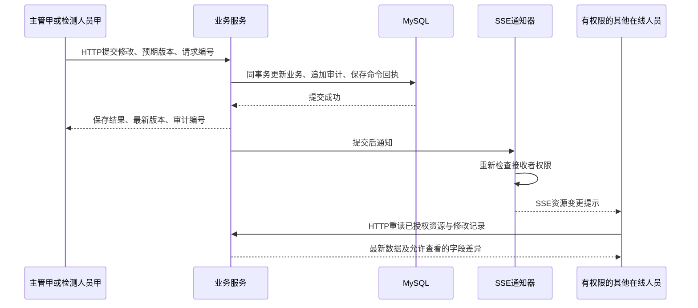

# 多角色协同操作与修改记录开发设计

日期：2026-11-10  
适用项目：中国铁路集装箱公司缺陷检测平台，`java-cloud` 模块化单体  
文档性质：本次讨论形成的开发设计，供实施和验收使用；不表示下述新增功能已开发、测试或部署。

选型更新：按用户确认，实时通知采用 **SSE + HTTP 接口**。业务修改通过 HTTP 提交，SSE 单向推送已提交的变更提示；本版替换原 WebSocket 通知设计。

## 1. 目标与业务约定

同一企业内，多名主管和多名检测人员可以同时登录。主管工作台与检测人员工作台使用同一套后端，根据登录身份显示对应菜单、数据和操作。多人修改业务数据后，相关人员能及时看到变化，并查清“谁在什么时候修改了什么”。

本轮已确定以下规则：

| 人员身份 | 登录系统 | 业务职责 | 系统权限 |
| --- | --- | --- | --- |
| 主管 | 是，可以有多名 | 管理检测、采集、维修人员，分配任务并处理审批 | 企业内最高业务管理权限，不另设管理员角色 |
| 检测人员 | 是，可以有多名 | 执行检测、提交结果及获授权的复核操作 | 本人及当前获授权任务的业务权限 |
| 采集人员 | 否 | 参与采集，关联采集批次、图片来源等记录 | 作为人员档案和业务参与者管理，不获得登录权限 |
| 维修人员 | 否 | 参与维修，关联维修、返修及处置记录 | 作为人员档案和业务参与者管理，不获得登录权限 |

人员岗位与登录权限分别管理。记录“采集人员张三”参与了某个批次，不表示张三操作过系统；实际录入人的账号必须另行记录。

新增功能包括：角色工作台的数据范围、业务修改记录、记录详情中的字段对比、SSE 变更通知、多人编辑冲突处理、重复提交保护及断线后的数据重读。

主管的最高权限适用于企业业务管理。已有私人聊天、私人记忆、未共享草稿和凭据等资源继续按其专属权限保护，不能通过审计页面绕过原资源授权。

## 2. 现有代码与待开发边界

已阅读项目说明及 ECS/Jenkins 运行约定。本设计沿用现有 Spring Security、Spring 事务、Vue/Element Plus 和审计持久化，不重新搭建用户系统。

| 现有入口 | 源码核对结果 | 本次需要补充 |
| --- | --- | --- |
| `AccountIdentityService`、`BusinessUserDirectoryImpl` | 已有稳定账号、员工绑定及主管/检测人员身份读取；部分位置兼容旧 `ADMIN`、`OPERATOR` | 登录资格结合人员岗位校验；对旧角色制定显式迁移清单，最终用户角色为 `SUPERVISOR`、`INSPECTOR` |
| `DetectionTaskAccessPolicy` | 已有检测任务数据范围入口 | 查询、修改、历史查询及推送共用资源授权规则，继续使用稳定账号关系 |
| `BusinessMutationAudit`、`OperationsAuditService` | 已有业务事务与基础操作元数据审计；记录操作者 ID、资源、动作和版本等信息 | 增加操作时身份快照、字段前后差异、记录详情及任务范围查询 |
| `GET /api/operations/audit` | 已有历史列表；主管查企业范围及本人私有记录，检测人员主要查本人记录 | 增加资源筛选和获授权任务的历史查询；保留旧列表响应兼容性 |
| `frontend/src/views/OperationsAudit.vue` | 已有操作审计列表、详情和文件交付记录 | 展示姓名、操作时角色、字段对比、筛选、更新提示及连接状态 |
| `audit_event`、现有业务表与业务命令回执 | 29 表目标结构中已有公共审计存储和部分领域幂等机制 | 扩展审计载荷版本及必要索引；未接入幂等的旧写接口逐项补齐 |
| `AuthController`、`JwtAuthenticationFilter`、`JwtUtil` | 已有登录/刷新/退出/身份查询、JWT及HttpOnly Cookie；请求按令牌中的稳定账号识别 | 明确独立登录会话、服务端撤销、账号状态和SSE会话绑定；旧页面在账号切换后禁止继续提交 |

本次已核对的入口尚不能证明完整 SSE 协同、通用字段差异审计、所有旧写接口幂等和所有业务资源版本校验已实现。以下章节均为目标行为和待开发要求。

现有基础审计只保存元数据，不能直接补出旧记录的字段原值。旧记录显示“历史未记录字段对比”，不得推测历史操作者姓名、操作时角色或修改内容。

当前源码中的退出接口主要清除浏览器Cookie，JWT生成代码尚未提供独立的 `sid` 会话标识；`TenantPrincipal.isEnabled()` 固定返回true。因此，多用户基础认证入口已存在，但不能据此宣称已实现单设备会话撤销、完整账号停用和即时关闭对应SSE连接。第3.3～3.7节明确这些待开发要求。

## 3. 权限与数据范围

### 3.1 权限矩阵

| 功能 | 主管 | 检测人员 |
| --- | --- | --- |
| 管理检测、采集、维修人员档案 | 企业范围内允许 | 默认不允许 |
| 管理登录账号和系统角色 | 允许，仅主管和符合资格的检测人员可开通登录 | 不允许 |
| 分派、调整任务负责人 | 允许 | 不允许自行扩大授权范围 |
| 查看检测任务及结果 | 企业业务范围 | 本人创建或当前被授权的任务 |
| 修改检测任务及提交结果 | 仍受任务状态和业务规则约束 | 同时检查任务授权、动作权限和当前状态 |
| 查询企业修改记录 | 企业业务范围 | 不提供全企业视图 |
| 查询本人操作 | 允许 | 允许；资源已不可访问时仅返回不泄露业务内容的本人操作摘要 |
| 查询单个资源的修改前后值 | 先通过当前资源及字段权限校验 | 仅当前可访问的任务及其允许读取的字段 |
| 更改、删除已生成的修改历史 | 不提供普通业务操作入口 | 不提供 |

菜单显示、接口鉴权、数据库查询范围和 SSE 接收范围必须一致。前端传入的 `userId`、角色、资源编号、操作者筛选条件都不能替代服务端当前身份。

### 3.2 授权变化

1. 查询审计列表、读取单条历史、订阅资源和发送每次通知前，检查当前账号及当前资源权限。
2. 任务重新分派后，原负责人按现有资源规则决定是否仍可访问；不能仅因曾经订阅成功就继续推送。
3. 权限失效时移除对应订阅，页面关闭无权读取的资源详情并清除其缓存；本地未保存草稿不自动上传。
4. 普通业务修改仍按业务状态机校验。拥有“查看任务”权限不自动获得分派、复核或审批权限。
5. 操作人取自服务端认证上下文；历史中的岗位参与人、任务负责人和实际操作人分别保存。

### 3.3 多用户同时登录的基本模型

同一套服务器同时接受多人的登录和业务请求。每位主管、每位检测人员使用自己的账号，角色只是账号的权限属性，不使用“大家共用一个主管账号”或“大家共用一个检测账号”。

| 在线用户示例 | 稳定账号ID | 角色 | 独立登录环境 | 服务端识别的登录会话 |
| --- | --- | --- | --- | --- |
| 主管甲 | `21` | `SUPERVISOR` | 电脑A的浏览器 | 会话A |
| 主管乙 | `22` | `SUPERVISOR` | 电脑B的浏览器 | 会话B |
| 检测人员甲 | `31` | `INSPECTOR` | 电脑C的浏览器 | 会话C |
| 检测人员乙 | `32` | `INSPECTOR` | 电脑D的浏览器 | 会话D |

上述用户可以同时在线。乙登录不会覆盖甲所在浏览器的凭据；同一角色的两个账号也分别具有自己的会话、任务范围、操作审计和实时连接。

单体应用通过请求线程池处理各人的HTTP请求，SSE使用异步响应。后端每次从当前请求的凭据识别用户，不能在单例服务、静态变量或公共缓存中保存一个所有请求共用的“当前登录用户”。IP地址不作为账号身份，同一单位共用公网出口不表示这些用户是同一人。

### 3.4 登录到业务操作的完整过程

1. 用户通过 `POST /api/auth/login` 提交自己的账号和密码，由后端校验密码、账号状态、人员关联及岗位登录资格。允许主管和检测人员登录；仅有采集或维修岗位的人员档案不具备登录资格。
2. 校验成功后，为本次独立登录生成不可预测的 `sid`。访问令牌及刷新令牌都绑定同一个 `userId` 和 `sid`，并区分令牌用途、有效期；角色及资源权限以后端当前事实为准。
3. 沿用现有 `DOOR_HANDLE_TOKEN` 与 `DOOR_HANDLE_REFRESH_TOKEN` HttpOnly Cookie；前端不把令牌存入可读本地存储。正式HTTPS环境使用Secure Cookie，继续遵守现有SameSite及写请求来源校验策略。
4. 页面通过现有 `GET /api/auth/check` 获取当前 `userId`、角色及人员身份，再展示主管或检测人员工作台。增加非敏感的 `accountContext` 标识，用于识别本页面对应的登录上下文，不能凭它完成认证。
5. 浏览器后续HTTP请求和SSE建连自动携带符合路径/来源规则的Cookie。后端验证签名、用途、有效期、会话有效性和当前账号状态，建立该请求自己的 `TenantPrincipal`，随后检查角色和资源权限。
6. 每个写请求还携带本页面的 `X-Account-Context`。如果已因其他标签页切换账号而与当前已认证会话不匹配，返回明确的账号上下文变化错误，不执行修改。该值只用于拒绝旧页面提交，实际操作人仍完全来自服务端认证身份。
7. 保存成功后写入实际操作者的修改记录，再向有权限的其他登录会话发送SSE提示；其他用户的登录状态不因该次保存而变化。

登录会话标识、操作请求编号、SSE连接编号、资源版本分别承担身份、幂等、连接和并发控制职责，不能混为同一个编号。

### 3.5 独立会话、刷新与退出

本方案允许同一账号在不同设备或独立浏览器环境登录；每次独立登录有自己的 `sid`。默认退出当前登录会话，既不退出其他账号，也不退出同账号其他设备。显式“退出该账号全部设备”作为不同操作处理。

为实现服务端撤销，设计复用现有 `runtime_state`，新增受约束的 `LOGIN_SESSION` 命名空间，不新增业务表。建议以 `owner_id=userId`、`scope_key=SHA-256(sid)` 定位会话，使用 `state_code` 表达有效/撤销，时间窗口表达创建及到期，`revision` 控制刷新竞争；版本化载荷保存必要的刷新凭据摘要和非敏感上下文元数据。不得保存原始密码、访问令牌或刷新令牌。

`runtime_state.session_id` 当前受SDK专属约束保护，本方案不直接占用该列；会话键使用 `scope_key`。该命名空间的字段映射、唯一性、过期清理及检查约束必须通过现有schema契约明确登记，不能把任意会话对象无约束塞入公共JSON。

- **刷新**：`POST /api/auth/refresh` 只刷新当前有效 `sid`，不影响其他登录会话。刷新和退出按同一会话版本串行判定；多标签页并发刷新需合并或返回一致结果，不能让迟到响应覆盖更新凭据。
- **退出当前会话**：服务端先撤销当前 `sid`，再清除对应Cookie并关闭该会话的SSE连接；旧凭据重放不能恢复此会话。前端立即清理显示状态，即使网络失败也不继续展示旧数据；未确认服务端退出时不宣称服务器已撤销。
- **账号停用或岗位资格撤销**：后端明确检查账号及岗位状态，并撤销相关会话；不能使用固定返回true的 `isEnabled()` 作为完整停用校验。该账号后续HTTP请求和实时通知均受限制。
- **角色或任务范围变化**：从当前账号和资源权限重新计算；不能仅依赖令牌签发时或SSE建立时缓存的角色。
- **清理**：过期会话按受控策略清理，保持必要的登录/撤销元数据审计，不能把会话清理扩展为业务数据删除。

这部分是目标设计，需补齐 `sid` 签发与校验、会话存储及退出/刷新逻辑后才能验收；现有Cookie清除接口不能直接替代服务端撤销。

### 3.6 同一浏览器与多个标签页的规则

| 使用方式 | 本期行为 |
| --- | --- |
| 多人分别在不同电脑或浏览器资料中登录 | 各自持有凭据，可以同时使用，互不覆盖 |
| 同一账号打开多个普通标签页 | 共享同一浏览器登录状态；各页面更新，连接数按第7.5节控制 |
| 同一浏览器资料先登录甲，再登录乙 | 同站点Cookie更新为乙；其他旧页面必须同步退出旧上下文、关闭旧SSE并重新读取身份 |
| 同一电脑要同时验证甲、乙、检测人员 | 使用不同浏览器或独立浏览器资料，隔离Cookie存储 |

本期Cookie方案不承诺普通标签页分别维持不同账号。无痕窗口是否共享同一无痕会话由浏览器决定，也不能把每个无痕窗口都当作独立账号环境。

通过跨标签页通知触发身份重读，页面重新获得焦点时也检查身份。清理旧表单、查询缓存、未完成请求和事件监听；迟到响应必须核对账号上下文后才允许展示。对于正在编辑的草稿，先阻止继续提交，再提示用户处理；不能因共享Cookie已变为乙而把甲的旧表单提交成乙的操作。

Cookie的存储及自动携带规则见 [MDN Cookie说明](https://developer.mozilla.org/en-US/docs/Web/HTTP/Guides/Cookies)。浏览器资料隔离是本方案的使用约定，不以客户端缓存中的角色作为授权依据。

### 3.7 多用户的SSE隔离与验收依据

服务端保存的每个实时连接至少绑定 `connectionId`、`userId`、`sid` 的摘要、会话到期信息及emitter；可通过连接ID注册，再以账号/会话建立索引。不能只使用 `Map<role, emitter>`，否则同角色用户会覆盖彼此连接；也不能只允许每个账号一个连接而覆盖其其他合法标签页。

通知按当前资源权限筛选后发送到相应账号的有效连接。退出会话A只移除A的连接；主管乙、其他检测人员及同账号其他有效设备继续使用。异步线程使用显式传递的受信身份，并重新检查会话和授权，不借用另一个请求线程的身份。

“多人能登录”“各人看到正确资源”“同一记录并发修改正确”分别验收。多用户身份隔离不要求给每个人单独部署服务器或数据库；两个用户有权操作同一资源时，仍由第6节的事务、版本和幂等控制写入。

## 4. 页面设计

### 4.1 两类工作台

主管工作台提供人员管理、任务管理、审批、企业模型额度和企业修改记录等入口。检测人员工作台提供本人待办、获授权检测任务、结果提交及相关修改记录等入口。具体业务菜单继续沿用现有路由授权，不因新增工作台批量开放写权限。

### 4.2 修改记录的三个入口

| 入口 | 展示内容 |
| --- | --- |
| 业务列表 | 最近修改人、最近修改时间、当前版本；提供“修改记录”按钮 |
| 业务详情的“修改记录”页签 | 当前资源的操作时间线、操作者、操作时角色、动作、字段前后对比 |
| 主管工作台的“操作审计”页面 | 按操作者、角色、业务类型、资源、动作和时间范围筛选，游标分页 |

检测人员的操作与主管的操作使用同一套记录机制，不能只记成“主管修改”或“检测员修改”。

显示示例：

> 张三 · 主管 · 2026-11-10 14:32:18（北京时间）  
> 检测任务 TASK-1023：负责人由李四调整为王五，版本 5 → 6

> 王五 · 检测人员 · 2026-11-10 14:35:42（北京时间）  
> 检测任务 TASK-1023：提交检测结果，版本 6 → 7

### 4.3 收到变更时的页面行为

| 页面状态 | 行为 |
| --- | --- |
| 正常浏览列表或详情 | 局部重读已授权数据，更新相关记录；保持筛选、滚动及选中状态 |
| 正在编辑同一条记录 | 保留未保存草稿；显示“张三已更新此记录”，提供“查看差异”“加载最新数据” |
| 正在编辑另一条记录 | 更新受影响的列表摘要，不重置当前表单 |
| 正在查看旧版本历史 | 保留当前历史位置，显示“有新修改记录”入口 |
| 保存响应尚未返回 | 使用请求编号关联通知；通知不能单独被当作保存成功回执 |
| 连接中断 | 显示“实时连接中断，正在重连”；继续允许按最新版本规则执行正常业务请求 |

不自动合并并发编辑，不自动将旧草稿覆盖到新版本。用户确认后的再次提交属于新的业务尝试，使用新请求编号并携带最新预期版本。

界面沿用白色、黑色、蓝色及现有开源图标。抽屉、时间线新增项和连接状态使用简短过渡；支持 `prefers-reduced-motion`，键盘焦点不因实时刷新跳走。

## 5. 修改记录内容

### 5.1 事件字段

| 字段 | 含义与来源 |
| --- | --- |
| `eventId` / `auditId` | 服务端生成的唯一事件编号及审计主键，接口按字符串传输 |
| `actor.userId` | 实际操作账号的稳定 ID，取自受信认证上下文 |
| `actor.username` / `actor.displayName` | 操作发生时的账号名及允许展示的姓名快照；姓名未知时如实显示 |
| `actor.role` | 操作发生时的 `SUPERVISOR` 或 `INSPECTOR`，不根据当前角色反推历史 |
| `domain` / `resourceType` / `resourceId` | 业务域、实际业务对象类型及编号 |
| `action` / `result` | 明确的业务动作及结果，例如 `ASSIGN`、`SUBMIT_RESULT`、`APPLIED` |
| `beforeVersion` / `afterVersion` | 该资源修改前后版本；没有可靠版本的旧事件显示未知 |
| `changes` | 服务端计算并脱敏的字段差异列表 |
| `requestId` | 关联该次业务请求和幂等回执，不由它推定所有旧接口已幂等 |
| `occurredAt` | 服务端 UTC 时间，接口返回带时区的 ISO 8601；页面显示北京时间 |
| `scope` | 沿用既有企业/私有范围，并叠加当前资源和字段级授权 |

删除或改名账号后，历史仍保留原稳定 ID 和操作时快照。业务对象删除后保留允许展示的删除摘要；资源删除后的历史查询由明确的历史资源权限规则判断。

### 5.2 字段差异规则

只记录每个业务域显式允许的字段，读取真实数据库旧值和实际保存的新值。不能将整个请求体、整个实体或所有 JSON 自动序列化为修改历史。

差异项包含 `field`、`label`、`operation`、`before`、`after`；结构化表达 SQL NULL、空字符串和字段移除，不能统一显示为空白。比较时按业务字段类型处理日期、数值和 JSON，避免格式差异被误报为业务变化。

密码、模型密钥、令牌和凭据只记录“已修改”，不保存明文、旧值或新值。电话等个人信息按字段策略脱敏。图片和附件记录业务文件 ID、版本或摘要，不保存文件正文、服务器路径和 OSS 签名地址；大结果记录结果版本及差异摘要，不复制整份检测输出。

没有实际字段变化时返回当前状态；默认不追加“已修改”事件。确有业务意义的无变化动作可以沿用 `NO_CHANGE`，页面必须明确显示。

### 5.3 覆盖动作

主管：人员新增/修改/停用、账号关联及角色调整、任务分派/重新分派、审批决定、企业模型配置和额度调整。

检测人员：任务领取/启动、采集资料关联、结果提交、获授权的检测信息修改、复核决定和退回重检。后台检测完成等自动动作使用明确的系统来源，不冒充前台检测人员；请求发起人与实际执行主体分别保留。

修改记录表示业务事实。HTTP 请求日志、失败尝试日志和后台任务执行日志分别保留各自意义，不能把“收到请求”或“排队成功”显示成“检测已完成”。

## 6. 数据库与事务设计

### 6.1 存储复用

本方案不新增业务表，沿用现有29表目标结构的 `audit_event`、`runtime_state`、业务实体存储及已存在的领域命令回执。不得另建“主管操作表”“检测员操作表”或每个业务域各建一张日志表。登录会话通过第3.5节的显式命名空间契约扩展，不改变表数。

审计继续使用 `kind='OPERATIONS'`。设计新增 `payload_version=2`，保留版本1已有的 `scope`、`domain`、`result`、`resourceVersion` 等含义，新增身份快照、实际业务对象类型、字段差异和前后版本。公共 `actor_user_id`、`resource_id`、`request_id`、`occurred_at` 等字段继续使用现有列。

现有 `resource_type='OPERATIONS'` 等结构约束按实际契约保留；业务对象类型通过新载荷显式表达。新增数据不得混入旧迁移的 `legacy_source` / `legacy_key`。

实施时必须同步修改载荷编解码、版本分派、该类型的检查约束和 API DTO。版本1与版本2都显式读取；不能把新字段塞进旧强类型载荷，也不能全局关闭未知字段检查。变更只针对 `OPERATIONS` 类型，其他审计类型的约束保留。

按真实查询计划评估同一表上的 `(kind, operation_domain, resource_id, id)` 等复合索引。索引及载荷契约纳入既有 schema 构建器、迁移、恢复和相关校验链；本文件不包含可直接执行的建表或迁移命令。

既有模型操作日志存在特定外键级联历史语义，新协同修改记录不能依赖其作为唯一证据；新 `OPERATIONS` 记录按追加方式保留，不随业务对象删除而级联删除。

### 6.2 一次修改的处理顺序

1. 从认证上下文获得操作者，核对当前账号、岗位登录资格、角色及资源权限。
2. 使用领域已有命令回执校验请求编号和规范化请求摘要。同编号不同内容返回冲突；确认为重复成功请求时返回原结果。
3. 在数据库事务内读取需要的旧值，检查业务状态并执行带预期版本的条件更新。
4. 条件更新成功后递增版本，计算允许记录的差异，在同一数据源、同一事务写入审计和命令回执。
5. 审计写入失败，业务更新和命令回执一并回滚；版本冲突不生成成功修改记录。
6. 事务提交成功后，发布轻量变更通知。通知失败不把已提交的业务回滚，也不把保存响应改成业务失败；记录投递问题，客户端通过重读补齐视图。

现有部分旧 CRUD 只有请求关联号，没有完整命令幂等。实施清单必须逐接口核实；缺少回执的领域要通过既有 `workflow_instance` 等命令存储的受约束扩展补齐，不能以“查到一条审计”替代原子幂等。

更新示意：在当前资源 ID、授权条件、允许状态以及 `revision=:expectedVersion` 同时满足时执行更新，并使 `revision=revision+1`。受影响行数为0时重新判定不存在、无权限、状态冲突或版本冲突；不能盲目重试覆盖。

并发版本负责保护业务资源，审计主键不充当资源版本。批量操作按固定顺序加锁，并保存真实资源明细；不得只写一个无法展开的 `collection` 来替代受影响对象。

## 7. SSE 实时同步

### 7.1 技术选择与流程

当前单体选用 Spring MVC `SseEmitter`，前端使用浏览器原生 `EventSource`。业务保存、审批和任务提交通过现有 HTTP 命令接口完成；SSE 推送资源变更、修改记录新增和检测进度等通知。这个选择对应当前主要由服务器向页面通知变化的需求。

页面使用普通 HTTP 查询重新读取数据及修改历史。连接上的 SSE 消息不承载客户端写命令，不能替代事务、版本校验、请求幂等和业务审计。Spring MVC 的发送能力见 [SseEmitter API](https://docs.spring.io/spring-framework/docs/6.1.5/javadoc-api/org/springframework/web/servlet/mvc/method/annotation/SseEmitter.html)。



提交后通知使用事务完成阶段的监听机制。该机制只解决触发时机，不提供持久消息投递保证；新的数据库写入不放进原事务已结束的回调中。设计依据见 [Spring 事务事件说明](https://docs.spring.io/spring-framework/docs/6.1.5/javadoc-api/org/springframework/transaction/event/TransactionalEventListener.html)。

### 7.2 连接鉴权与订阅

建议使用 `GET /api/realtime/changes`，响应类型为 `text/event-stream`。默认同源，通过现有 HttpOnly 认证 Cookie 和 Spring Security 验证账号、访问令牌类型及有效期；每次重连都是重新鉴权的 HTTP 请求。跨源使用时，仅允许明确的 Origin，并按实际 Cookie 策略启用凭据，不能搭配通配符来源。

原生 `EventSource` 不提供任意自定义 Authorization 请求头的入口，本方案复用 Cookie，不将访问令牌、刷新令牌或密码写入 URL。SSE GET 只建立读取通道，不修改业务数据，也不因建连生成业务修改记录。

每个页面应用实例维护一个共用事件流，由后端按当前账号生成授权通知范围：主管接收企业业务变更，检测人员接收本人及当前可访问资源的相关变更。组件共用连接，不按表格、任务或业务模块分别建立连接。若接口支持业务域或资源过滤，过滤只缩小接收范围，并逐项校验权限。

连接建立后保存当前用户 ID、受信会话标识摘要及连接 ID，按第3.5节检查会话状态；异步线程不能依赖原 HTTP 线程的 SecurityContext。每次发送前重新核对会话和当前权限，不能永久信任建连时的角色。登出、禁用账号、令牌过期或登录资格撤销后结束相关 emitter，客户端关闭旧 `EventSource` 并清理旧账号数据。

任务重新分派等导致接收范围变化时，向受影响的在线账号发送不含资源编号和业务内容的 `resync-required` 控制事件，要求重读当前身份和当前页面资源。业务查询返回无权限后清除对应视图，不再向原负责人发送该资源的变更提示或字段详情。

SSE 是服务器到浏览器的通道。页面不能通过 `EventSource` 发送订阅命令或心跳应答；本期范围由服务端派生，必要的过滤变化通过新的已鉴权 HTTP 请求处理。

### 7.3 通知格式与客户端处理

```json
{
  "schemaVersion": 1,
  "type": "RESOURCE_CHANGED",
  "eventId": "change-demo-7f2c",
  "auditId": "900001",
  "domain": "DETECTION",
  "resourceType": "DETECTION_TASK",
  "resourceId": "TASK-1023",
  "resourceVersion": "6",
  "occurredAt": "2026-11-10T06:32:18.123Z"
}
```

上述 JSON 是 SSE 的 `data` 内容，传输帧示例如下；每个事件以空行结束：

```text
retry: 3000
id: change-demo-7f2c
event: resource-changed
data: {"schemaVersion":1,"type":"RESOURCE_CHANGED","eventId":"change-demo-7f2c","auditId":"900001","domain":"DETECTION","resourceType":"DETECTION_TASK","resourceId":"TASK-1023","resourceVersion":"6","occurredAt":"2026-11-10T06:32:18.123Z"}

```

前端通过 `addEventListener('resource-changed', ...)` 接收命名事件；不能只监听 `onmessage` 而漏掉命名事件。后端使用结构化事件构建器生成 `id`、`event` 和 JSON 数据，字段不接受用户输入的换行控制字符。事件格式依据 [WHATWG SSE 标准](https://html.spec.whatwg.org/multipage/server-sent-events.html)。

推送只包含最小定位元数据；姓名、角色、字段前后值及业务详情通过重新鉴权的 HTTP 查询读取，再生成“张三修改了任务”提示。不能向所有主管或所有检测人员广播完整业务行，也不广播私人资源名称和内容。

同一账号可有多个浏览器连接。保存者的其他标签页同样接收通知；当前页面通过审计编号与版本避免重复提示。前端按 `eventId` 去重，并按同一资源版本拒绝倒退；版本跳跃或未知事件版本触发重新读取，不根据相邻事件推导缺失修改内容。全部大整数 ID 和版本按字符串传输。

### 7.4 断线、漏通知和慢连接

本期将数据库审计作为持久事实，SSE 为尽力通知，不承诺每条通知恰好一次到达。正常在线时由 SSE 尽快更新；通过以下机制补齐视图：

- 使用原生 `EventSource` 的自动重连及服务端 `retry` 提示，建议初值3000毫秒；不同时叠加另一套无限重连计时器。需要由应用主动关闭重建时，统一连接状态机管理单个实例和单个重建计时器，并为重试设置上限与抖动。
- 每次流建立后，服务端先发送不含业务敏感信息的 `resync-required` 事件，前端重新读取当前资源、当前查询第一页和当前身份。浏览器自动重连和收到 `id` 均不代表服务端已补发断线期间的事件。
- 页面恢复可见、网络恢复时重新读取；可见页面每30秒校验当前资源版本或当前查询第一页，批量校验并限制频率。
- 服务端建议每25秒发送一次不带 `id` 的 `heartbeat` 命名事件，客户端记录收到事件的时间，不发送应答。连续60秒未收到任何事件时，将连接标记为异常并由统一状态机重建；代理读超时应大于保活周期。以上均为待ECS验证的可配置初值。
- `EventSource.onerror` 本身不能当作已取得HTTP状态码。发生错误时通过现有身份读取接口确认登录状态；身份失效、用户登出或切换账号时显式调用 `close()`，停止旧连接恢复并清空旧账号数据，避免无效重连循环。
- 服务端使用每个 emitter 的有界发送队列和有界执行器串行发送，设置异步响应生命周期和发送保护；慢连接及时结束，不能阻塞其他用户或无限堆积。`onCompletion`、`onTimeout`、`onError` 路径都要移除连接及其定时任务。

历史列表的 `before` 游标只用于浏览更早的已提交记录，不作为可靠事件补发游标。SSE `id` 用于事件标识和去重；浏览器重连时可能携带的 `Last-Event-ID` 在本期只作为恢复线索，不承诺历史回放。自增审计 ID 和事件时间都不保证事务提交顺序，不能用“所有审计 ID 大于最后一个 ID”声称完整补发。资源详情以最新业务版本重读，历史记录始终可以按授权查询。

自动重连、事件类型、重试提示及最后事件标识的协议语义见 [WHATWG EventSource 定义](https://html.spec.whatwg.org/multipage/server-sent-events.html)；本文的重新鉴权、资源重读和去重是应用需要另外实现的逻辑。

### 7.5 代理、多标签页与连接预算

事件流响应采用 `text/event-stream` 和UTF-8，设置适合流式响应的 `Cache-Control: no-cache, no-store, no-transform`。在实际反向代理的 SSE 路径关闭响应缓冲和代理缓存，确认压缩链路不积攒事件；使用Nginx时可配置该路径的 `proxy_buffering off`、`proxy_cache off`，并结合 `X-Accel-Buffering: no` 和适当读超时验证效果。不要将这些流式配置扩展到全部普通业务接口。

浏览器到反向代理优先使用HTTP/2，并实际验证协商结果。HTTP/1.1下多个标签页会共享同源连接限额；已有模型流式输出也可能占用长连接，不能仅按“每页一个流”就认定多标签页可用。HTTP/1.1部署必须落实同账号跨标签页共享流，或明确限制同时打开的标签页，并验证普通保存请求不会被长期占满的连接阻塞。连接限制与流式发送示例见 [MDN SSE 使用说明](https://developer.mozilla.org/en-US/docs/Web/API/Server-sent_events/Using_server-sent_events)。

跨标签页若共享事件，频道及缓存必须按已认证账号和登录代次隔离；切换账号后旧实例退出。不得把来自其他标签页的账号标识当作后端授权依据。此共享机制属于待开发内容，不能据浏览器自带 `EventSource` 推定已实现。

未来若要求逐事件离线补发或部署多个后端实例，应另行设计持久化 outbox、投递确认和跨实例广播；不能直接把当前内存通知器用于分布式可靠投递。本期不为该功能新增 Redis/Kafka 集群。

## 8. 接口约定

下列新增或扩展接口为开发目标，路径需在实施时与现有 Controller 一致登记。

| 接口 | 用途 | 要求 |
| --- | --- | --- |
| `POST /api/auth/login` | 现有登录入口，扩展独立会话签发 | 校验账号和岗位资格，签发绑定当前账号及 `sid` 的Cookie凭据，不将令牌返回为前端可读存储 |
| `GET /api/auth/check` | 现有身份读取入口 | 返回当前稳定账号、角色和人员身份；新增非认证凭据的 `accountContext`，供页面防止账号切换串号 |
| `POST /api/auth/refresh` | 现有刷新入口，补齐会话及版本校验 | 仅刷新当前有效会话，处理多标签页刷新竞争，撤销后不能恢复 |
| `POST /api/auth/logout` | 现有退出入口，补齐服务端撤销 | 撤销当前 `sid`、清理Cookie及对应SSE；不退出其他账号或其他有效设备 |
| `GET /api/operations/audit` | 现有基础审计列表 | 保持现有兼容字段和原权限；字段缺失不伪造历史 |
| `GET /api/operations/audit/changes` | 新修改记录列表 | 支持业务域、资源、操作者、角色、动作、时间范围及 `before`、`size`；所有筛选与授权条件取交集 |
| `GET /api/operations/audit/changes/{eventId}` | 单条修改详情 | 再检查当前资源及字段权限；返回身份快照和允许展示的差异 |
| `GET /api/realtime/changes`，`text/event-stream` | 建立SSE事件流 | 完成身份及来源策略校验，按当前权限单向推送；支持 `resource-changed`、`heartbeat`、`resync-required` 命名事件 |
| 既有业务写接口 | 实际修改数据 | 校验 `X-Account-Context` 以拒绝旧账号页面提交；携带 `expectedVersion` 和 `requestId`，返回保存结果、最新版本及审计编号 |

示例修改详情：

```json
{
  "eventId": "change-demo-7f2c",
  "actor": {
    "userId": "21",
    "username": "supervisor-a",
    "displayName": "张三",
    "role": "SUPERVISOR"
  },
  "domain": "DETECTION",
  "resourceType": "DETECTION_TASK",
  "resourceId": "TASK-1023",
  "action": "ASSIGN",
  "result": "APPLIED",
  "beforeVersion": "5",
  "afterVersion": "6",
  "changes": [
    {
      "field": "assigneeUserId",
      "label": "任务负责人",
      "operation": "REPLACE",
      "before": { "userId": "31", "displayName": "李四" },
      "after": { "userId": "32", "displayName": "王五" }
    }
  ],
  "requestId": "request-demo-assign-001",
  "occurredAt": "2026-11-10T06:32:18.123Z"
}
```

示例姓名、账号和编号均为说明数据。接口不得允许客户端自行填写操作者或历史时间。

列表默认50条，最大100条；筛选字段使用白名单并限制长度，时间范围支持索引查询。详情与列表使用 `Cache-Control: no-store`；应用内缓存至少包含稳定账号、权限范围和资源版本，切换账号时清空并关闭旧连接。

错误语义：未登录、令牌失效或会话已撤销返回401；无权限返回403或沿用资源防枚举的404；版本、状态、请求摘要或账号上下文冲突返回409，具体错误码区分处理；参数错误返回400。业务事务或必要审计失败返回明确失败，不能展示“保存成功”；通知失败则保留已成功的保存结果，仅降级实时状态。

## 9. 模块分工与开发步骤

| 模块 | 计划工作 |
| --- | --- |
| `doorhandle-contracts` | 定义版本化修改差异 DTO、提交后事件及资源授权端口；保持既有审计调用兼容 |
| `doorhandle-module-system` | 独立登录会话与撤销、当前账号及岗位校验、身份快照、载荷版本读取、历史查询鉴权、SSE emitter及授权通知范围管理 |
| `doorhandle-module-detection` 等业务模块 | 字段差异白名单、真实旧值读取、版本条件更新、业务状态及命令回执；调用共用审计端口 |
| `doorhandle-module-app` | 安全过滤链、SSE异步响应端点装配、超时配置和反向代理接入 |
| `frontend` | 两类角色入口、多标签页账号切换同步及旧请求隔离、修改记录列表/页签、字段对比、共用EventSource连接管理、草稿冲突交互 |
| `script/schema`、既有 SQL 契约 | 登录会话命名空间、审计载荷版本2、相应约束与索引、旧版本兼容、迁移和恢复校验 |

实施顺序：

1. 先完成角色/岗位/资源/字段权限矩阵、旧角色迁移清单及多用户会话隔离；明确哪些账号可以登录、哪些字段允许查询和审计。
2. 完成版本化审计存储与 HTTP 修改历史查询，再逐领域接入事务、版本和幂等；先验证数据事实正确。
3. 接入提交后SSE通知、接收范围授权、自动重连后的重读、代理流式配置及连接预算。
4. 完成主管与检测人员页面及多人编辑提示，统一处理同账号多标签页和切换账号。
5. 通过本地 Jenkins 在 ECS 执行验收，再按原发布门禁安排部署；数据库重构未验收时不提前切库。

新增功能按独立开关分步开放。已有必要基础审计保持；已接入的新修改记录写入失败时不能静默降级成无审计写入。SSE开关关闭时，历史查询和手动刷新继续工作，客户端关闭流并停止无意义的恢复尝试。

## 10. 验收清单

| 编号 | 场景 | 通过标准 |
| --- | --- | --- |
| A01 | 两名主管、两名检测人员同时登录 | 会话和当前身份各自独立，菜单及数据范围正确 |
| A02 | 管理采集、维修人员 | 能建立和关联人员档案，不能据此获得系统登录权限 |
| A03 | 检测人员提交变化 | 历史显示具体账号、操作时角色、时间、真实资源及变化内容 |
| A04 | 两名主管或两名检测人员同时修改同一版本 | 仅一个修改成功，另一方收到409；只生成一份成功变更和对应回执 |
| A05 | 两人同时领取同一任务 | 仅一人获得任务，负责人和领取历史一致 |
| A06 | 重复点击、网络重试 | 同一请求编号及相同内容返回原结果，不重复扣额度、创建结果或写成功历史 |
| A07 | 相同请求编号提交不同内容 | 明确冲突，不执行第二份内容 |
| A08 | 必要审计写入失败 | 业务、版本和命令回执一起回滚；不推送成功变更 |
| A09 | 浏览页面收到他人更新 | 局部更新数据和历史，保持当前筛选、滚动、焦点及分页语义 |
| A10 | 编辑表单收到他人更新 | 保留草稿并提示冲突，不静默覆盖；确认重读后再提交 |
| A11 | 猜测他人资源/事件ID或伪造流过滤条件 | HTTP查询与SSE推送均拒绝越权，不能泄露字段前后值及资源元数据 |
| A12 | 任务重新分派、账号降权、禁用或登出 | 旧订阅和后续查询按当前权限撤销，旧账号页面数据被清除 |
| A13 | 断网、服务重启、漏通知、重复或乱序通知 | 重连/重读后显示数据库最新版本，无重复提示和版本倒退 |
| A14 | 提交后通知失败 | 原保存结果保持成功，修改历史可查询，可见页面后续校验恢复视图 |
| A15 | 同账号多标签页、切换账号 | 多标签页及时更新；切换后不继续展示或接收旧账号数据 |
| A16 | 旧版本历史、账号改名/删除、资源删除 | 历史稳定身份保留，未知值如实显示；删除摘要和详情按权限区分 |
| A17 | 凭据、附件及大型结果变更 | 无密码、密钥、令牌、签名URL或文件正文泄露；差异可理解且有界 |
| A18 | 数据结构升级与恢复 | 表数不增加，版本1/2显式兼容，相关约束、索引、迁移与恢复链通过 |
| A19 | 持久化和重启 | 已提交业务与审计一一对应，服务重启后历史可读；未提交变更不显示成功 |
| A20 | 并发连接和慢连接 | 有界发送队列，无无限内存增长；慢连接不阻塞其他用户 |
| A21 | 代理缓冲、HTTP/2及多标签页 | 实际事件逐条到达；记录客户端协商协议；HTTP/1.1连接预算和已有模型流不阻塞保存请求 |
| A22 | SSE重连、命名事件及权限失效 | 命名事件被正确接收；自动重连后重新鉴权并重读；无效登录明确关闭流，全部结束路径释放资源 |
| A23 | 携带 `Last-Event-ID` 恢复连接 | 不将审计自增ID误当提交序列；先触发重新同步，不宣称未实现的历史补发 |
| A24 | 不同用户在独立浏览器环境并发登录 | 稳定账号和角色分别正确，甲的登录/刷新/退出不覆盖乙或其他检测人员的凭据与数据 |
| A25 | 同账号在两台设备登录，退出其中一台 | 各自会话标识不同，只撤销目标会话；另一设备仍可操作并接收授权通知 |
| A26 | 同一浏览器从甲切换乙，甲的旧页面仍有草稿或迟到请求 | 旧连接及缓存清除；旧上下文写请求被拒绝，不能变成乙的操作或展示旧账号响应 |
| A27 | 多标签页并发刷新以及刷新与退出竞争 | 刷新结果一致且不被迟到凭据覆盖；撤销后不再签发有效会话，也不恢复SSE |
| A28 | 账号停用、岗位登录资格撤销，旧JWT仍未过期 | 后端按当前状态拒绝HTTP及实时连接；采集/维修人员不能因残留令牌继续使用系统 |

性能验收建议先以20个并发登录用户、每用户2个标签页为基线，在明确记录ECS配置、业务数据规模和负载条件后测量。健康连接下，提交到其他页面更新的 P95 目标不超过2秒；漏通知情况下，可见页面按30秒校验周期恢复最新视图。两项是待验证目标，不是现有性能结论或任意规模容量承诺。

验收证据至少包括固定提交、Jenkins构建号、真实并发请求结果、数据库业务/审计/回执读回、权限拒绝结果、浏览器多用户交互及连接恢复记录。

## 11. 开发、部署与交付约束

本地仅编辑、构建及运行已有 Jenkins 控制器，不运行应用、前端预览、数据库或测试。通过现有 `Jenkinsfile.ecs-monolith` 和 `doorhandle-local-ci` 调度 ECS 执行所有测试，使用已提交推送的固定源码。

ECS 启停继续在流水线外进行；测试结束收集证据、清理本轮拥有的测试资源，再实际核对 `Stopped / StopCharging`，Jenkins保持运行。本文档交付只新增设计文档，不启动ECS、不触发流水线、不迁移数据或修改应用配置。

交付物为角色和数据权限矩阵、领域字段白名单、版本化存储与接口、两个工作台页面、SSE配置与降级策略、数据库升级/恢复方案及ECS验收报告。未完成这些交付物前，不将“有连接”或“能看到部分日志”记作功能完成。

## 12. 源码依据与技术参考

项目依据：

- [项目说明](../README.md)、[ECS运行约定](ECS-only-runtime.md)、[本地Jenkins CI/CD](本地Jenkins-CICD.md)。
- [现有多用户权限与数据范围](多用户权限与数据范围方案.md)、[业务审计覆盖与文件交付](业务审计覆盖与文件交付.md)、[模型与基础操作审计适配](模型与基础操作审计适配-20261106.md)。旧文档的管理员兼容和历史本地测试描述，以当前用户要求及ECS运行约定为准。
- [身份服务](../doorhandle-module-system/src/main/java/com/ruanzhu/doorhandle/module/system/service/AccountIdentityService.java)、[审计服务](../doorhandle-module-system/src/main/java/com/ruanzhu/doorhandle/module/system/service/OperationsAuditService.java)、[审计载荷](../doorhandle-module-system/src/main/java/com/ruanzhu/doorhandle/module/system/service/OperationsAuditPersistence.java)、[事务切面](../doorhandle-module-system/src/main/java/com/ruanzhu/doorhandle/module/system/service/BusinessMutationAudit.java)。
- [现有登录/刷新/退出及身份接口](../doorhandle-module-system/src/main/java/com/ruanzhu/doorhandle/module/system/controller/AuthController.java)、[JWT请求身份过滤](../doorhandle-module-system/src/main/java/com/ruanzhu/doorhandle/module/system/security/JwtAuthenticationFilter.java)、[JWT生成与校验](../doorhandle-module-system/src/main/java/com/ruanzhu/doorhandle/module/system/util/JwtUtil.java)、[前端登录状态](../frontend/src/stores/user.js)、[共享运行状态结构](../sql/mysql/compact/001-coordination-state.sql)。
- [现有审计接口](../doorhandle-module-system/src/main/java/com/ruanzhu/doorhandle/module/system/controller/OperationsAuditController.java)、[现有审计页面](../frontend/src/views/OperationsAudit.vue)、[目标审计表结构](../sql/mysql/compact/005-workflow-runtime.sql)。

技术选型优先复用 Spring MVC已有SSE与事务设施。已核对 `SseEmitter`、`EventSource`及事务提交后监听语义，不引入独立用户平台或新的浏览器同步框架。现有 `pom.xml` 声明 Spring Boot 3.2.4；实施时以该提交实际依赖解析结果为准，不照搬最新大版本示例升级依赖。

- [Spring 6.1.5事务事件 API](https://docs.spring.io/spring-framework/docs/6.1.5/javadoc-api/org/springframework/transaction/event/TransactionalEventListener.html)：核对事务提交后监听及无事务时的语义。
- [Spring 6.1.5 SseEmitter API](https://docs.spring.io/spring-framework/docs/6.1.5/javadoc-api/org/springframework/web/servlet/mvc/method/annotation/SseEmitter.html)：服务端事件发送、异步响应及完成/超时/异常回调依据。
- [WHATWG SSE / EventSource标准](https://html.spec.whatwg.org/multipage/server-sent-events.html)：事件流、自动重连及最后事件标识的协议依据；权限、完整补发和业务一致性由应用实现。
- [MDN SSE使用说明](https://developer.mozilla.org/en-US/docs/Web/API/Server-sent_events/Using_server-sent_events)：核对浏览器事件监听、重连、HTTP版本连接预算及流式响应配置。
- [MDN HTTP Cookie说明](https://developer.mozilla.org/en-US/docs/Web/HTTP/Guides/Cookies)：凭据保存、后续请求携带及同站点作用范围依据；不把浏览器显示缓存当作认证来源。
- [Spring Framework Apache-2.0许可证](https://raw.githubusercontent.com/spring-projects/spring-framework/v6.1.5/LICENSE.txt)：继续通过项目依赖管理使用，复制源码时保留相应版权和许可声明。本次仅编写设计，没有复制外部实现或安装依赖；后续实施仍需核对实际版本维护状态和兼容性。
