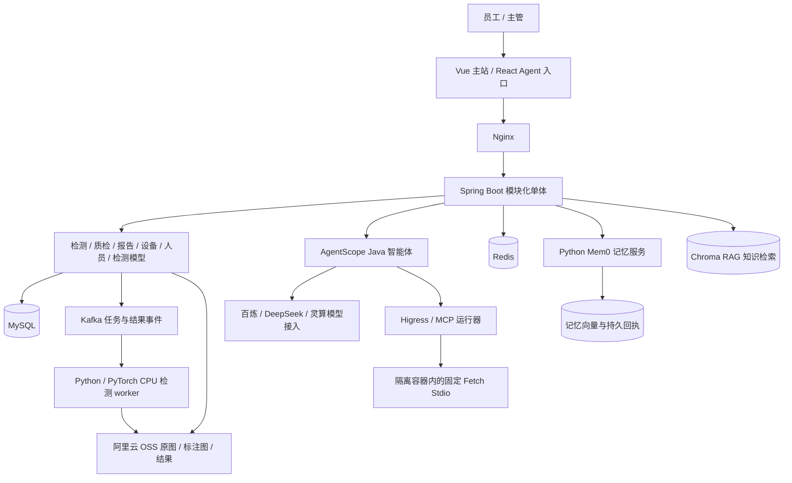

# 集装箱门把手检测与 Agent 协同系统功能说明

更新日期：2026-10-22（UTC+8）

新增业务流程优化第一步源码：统一任务级质检条件、主管闭环归档、分派保留阶段、返工后复检顺序、暂挂后重新处置及事务行锁。页面和 Agent 分派共用业务规则，进度/结果附带动作提示；Vue 主页面复用既有质检操作逻辑，刷新按当前空值、零及 false 更新。尚未编译、测试或部署，逐图复核与实际复检闭环仍待下一步，见 [分步记录与边界](docs/单体业务流程逐步优化.md)。

持久上下文新增来源绑定源码：实际工具身份校验、业务文件/原图重新授权、子任务来源快照及隔离 Fork 继承；工具重用不跟随后续子任务改写，发布保护要求 context 2。默认关闭，未编译、测试或部署，聚合范围等缺口仍待补齐，见 [上下文说明](docs/Agent持久上下文与受控卸载.md)。

新增缺失历史名称的主管受控确认源码：逐条确认资料编号与目标账号、保留原空值、同事务批次/来源/审计、v3 回执及业务清空后的撤销。需 V61 与默认关闭开关，发布保护要求 evidence 2；尚未编译、测试、迁移或部署，见 [实现范围](docs/缺失历史名称的受控账号确认.md)。

新增固定 Fetch 运行器升级与部署镜像保留源码：停止后读取 journal 副本、保留同一卷/pool、兼容选择、失败恢复、发布记录及当前/上一/过渡镜像保护。需 V60，后端协议 4、runner 生命周期 2；Jenkins 和隔离演练已接线但尚未运行。首次兼容基线与最终验收待完成，默认关闭共享回收，见 [实现边界](docs/MCP运行器升级与部署镜像保留.md)。以下同日较早段落为对应阶段记录。

新增共享 Fetch 镜像回收源码：MySQL 跨账号引用封存与命令、SQLite 运行器禁入、许可证持久归档、非强制删除、只读核对及主管卡片；App/AI 通过 contracts 分工，候选环境不允许删除宿主共享镜像。需 V59 与默认关闭开关，协议声明 3；未编译、测试、构建或部署，运行器升级编排和最终验收继续保留，见 [实现与边界](docs/固定Fetch共享镜像回收.md)。

新增 MCP 原生协议发布保护源码：后端镜像声明、固定元数据检查、与 MySQL 卷绑定的持久下限、Jenkins 发布/回滚及隔离演练接线；支持单独暂停新安装与执行而保留原资源退出核对。未运行或验收，首次兼容基线与共享镜像回收继续保留，见 [MCP 发布保护](docs/MCP原生协议发布与回滚保护.md)。

新增固定 Fetch 原生安装进程树回执源码：Linux subreaper/pidfd、SQLite 持久安装身份、MySQL 派发证据、AgentScope SDK 安装握手账本、本人额度及退出核对页面。新开关默认关闭，需 V58，尚未编译、测试或部署；共享镜像删除和兼容恢复保护仍待开发，见 [实现范围与接入条件](docs/固定Fetch原生安装进程树回执.md)。

新增身份快照核对源码：主管可生成五类关联的有界一致快照，查看差异、摘要及前次观察比较，从明细重新打开当前任务预览；不把旧报告当作当前授权。需 V57 及默认关闭开关，未编译、测试、运行报告或部署。空名称补正及最终迁移等仍待开发，见 [历史核对摘要](docs/历史身份快照核对与迁移摘要.md)。

身份来源续开发：新增实际创建/分派/人工操作和主管回填来源记录，先收集、核对后激活，来源匹配接入原授权策略。回填页支持批次明细和刷新后按原编号只读查询；需 V56 与默认关闭开关，源码未编译、测试或部署。旧写入核对摘要和最终迁移仍待完成，见 [身份来源与回执导航](docs/身份来源保护与回执导航.md)。

历史账号回填新增主管明确选择目标账号、固定资料摘要、核对依据、版本冲突和批次回执源码；未知结果只读核对，原账号失效进入待映射。需 V55 及默认关闭开关，尚未编译、测试或部署；历史来源证明和最终迁移继续开发，见 [回填确认与回执](docs/历史账号回填确认与批次回执.md)。

分派部署保护新增源码：发布前检查确认数据及身份格式与恢复镜像声明，保存单独暂停分派写入的状态，候选演练和发布回执明确区分兼容基线与候选。尚未运行或验收，首次基线与最终迁移编排仍待完成，见 [分派兼容回滚](docs/分派数据格式与兼容回滚.md)。

质检分派补充：Agent 提议与人工表单固定责任人 ID/账号快照，V54 可记录分派操作人和身份版本；两套卡片显示对应信息，陈旧版本拒绝。新增代码未编译、测试或部署，V54 开关默认关闭，兼容发布和回滚保护仍待完成。见 [分派身份设计](docs/质检分派固定账号与操作人.md)。

稳定账号关联续开发：检测授权策略使用受信账号 ID，新业务操作在原事务中保存创建人、责任人及人工操作人关联，后台同步不再按同名自动回填历史归属。授权模式仍须先完成回填再由主管激活，目标账号确认绑定和迁移收尾未完成；新代码未编译、测试或部署。见 [稳定身份与显式操作关联](docs/稳定身份授权与显式操作关联.md)。

历史本地文件入口新增真实任务/模型授权和交付关联，写出前重新校验，模型文件只对当前主管开放且必须有唯一登记。旧未登记模型上传源码改为 410；交付页面区分 HEAD 无正文和 GET 写出。当前只是新增代码，未编译、测试或部署，完整审计仍未收尾。见 [历史文件交付](docs/历史文件入口权限与交付审计.md)。

本日续开发模型文件意图与保留：上传写入和登记事务拆分，异常不删文件，模型删除先登记保留证据；模型页面支持按请求编号只读核对。需 V53 和独立默认关闭开关，新代码未编译、测试、迁移或部署，物理回收与遗留文件处置继续开发。见 [模型文件登记与保留](docs/检测模型文件登记与保留.md)。
适用分支：`java-cloud`  
说明依据：当前源码、部署配置、功能文档和已有验收记录。

本文介绍已经实现的功能、使用场景及主要技术。**代码已实现、功能开关已启用、生产部署已验收是不同状态**；最近的界面、模型治理和检测回执改动尚未统一发布，不应将本文当作当前服务器全部能力已开启的证明。最新交付状态见 [开发进展](开发进展.md)。

阅读导航：账号权限见第 2 节，检测与质检见第 3 节，设备人员与检测模型见第 4 节，Agent 对话和任务工作台见第 5 节，文件与记忆见第 6 节，Skill/MCP 见第 7 节，界面、评测和部署见第 8 节。第 9 节单独列出尚未完成统一交付的实现。

文中“已实现”表示当前分支存在对应代码；标注“需开关”的功能还需要迁移及部署配置；“待验收”表示尚未满足该项完整放行要求。除明确注明的历史验收外，不将本地专项通过视为当前生产版本通过。

2026-10-22 业务审计新增实际资源编号/整数版本、遗漏业务动作及报告事务关联，并增加 V52 文件交付尝试和原审计页展示。响应完成只表示服务端观测到写调用结束，不证明浏览器收到了文件；OSS 重定向只记授权。新代码未编译、测试、迁移或部署，旧文件及模型物理文件事务等缺口仍保留，见 [业务审计与文件交付](docs/业务审计覆盖与文件交付.md)。

## 1. 系统定位与整体技术架构

系统面向集装箱门把手的图片检测、人工质检和结果追溯，通过角色受限的 AI 助手连接检测、报告、设备和模型信息。员工处理本人及分派任务，主管查看企业业务范围；私人对话、记忆和确认记录按账号隔离。

业务后端采用 **Java 模块化单体**。Python 检测 worker、Mem0 记忆服务及 MCP 运行器独立运行，多个容器共同支撑系统，但当前没有完成 Java 业务微服务拆分。

| 技术层 | 当前使用技术 | 用途 |
| --- | --- | --- |
| 主站前端 | Vue 3、Vue Router、Pinia、Element Plus、ECharts、Vite | 业务页面、账号状态、统计图表和主站聊天 |
| 独立 Agent 前端 | React 18、Ant Design、AgentScope Chat/Design、Lucide、Vite | 独立聊天、工作面板、结构化结果和流式交互 |
| Java 后端 | Java 17、Spring Boot 3.2.4、MyBatis-Plus、Spring Security | HTTP 接口、权限、业务事务和模块装配 |
| 智能体框架 | AgentScope Java 2.0.4、Harness、ReAct、工具白名单、AG-UI | 主 Agent、专业委派、工具执行及事件输出 |
| 推理服务 | Python、PyTorch、原始 PTH 权重 | 六类门把手检测，当前服务器使用 CPU |
| 数据与消息 | MySQL、Redis、Kafka | 业务与会话持久化、缓存/协调、异步检测和事件交付 |
| 文件与检索 | 阿里云 OSS、账号私有持久卷、Chroma | 业务图片和结果、会话资料、知识检索 |
| 长期记忆 | Mem0、FastAPI、Chroma、SQLite 持久回执/历史 | 跨会话记忆提炼、检索与治理 |
| MCP 接入 | Higress、Streamable HTTP、Stdio、Docker、受限出口代理 | 固定 Fetch 工具的网关访问和隔离执行 |
| 构建与部署 | Maven、pytest、Node Test、Playwright、Jenkins、Docker Compose、Nginx、SSH | 自动检查、镜像构建、ECS 部署及验收 |

上述基础组件的 Compose 配置使用 MySQL 8.4、Redis 7.4 和 Kafka 4.2.2；具体运行版本仍以部署镜像及发布记录为准。

## 2. 账号、权限与多用户协作

| 已实现功能 | 功能简介 | 主要技术与实现方式 |
| --- | --- | --- |
| 登录、退出和登录状态校验 | 用户通过账号密码登录系统，服务端核对账号及角色 | Spring Security、JWT、HttpOnly Cookie、密码摘要校验 |
| 登录保护 | 限制短时间内的异常登录尝试，前端区分账号错误、超时和连接失败 | 服务端登录限流、统一错误处理；最新提示优化尚未发布 |
| 多用户同时使用 | 不同用户可以同时登录，分别创建任务和会话 | 服务端账号上下文、数据库记录归属、会话互斥和有界调度 |
| 员工与主管角色 | 员工看本人及分派业务，主管看企业业务范围 | 角色校验、业务查询范围过滤、文件读取重新鉴权 |
| 账号、员工、部门关联 | 主管维护账号与在岗员工资料的关联，员工查看本人身份 | 系统/设备模块、contracts 门面、版本校验与事务审计 |
| 私人 Agent 数据隔离 | 会话、记忆、私有资料和确认记录不因主管角色而公开 | 稳定账号身份、账号范围查询、私有资源编号与服务端授权 |

目前是单企业内多用户方案，没有完成多租户企业隔离。历史检测记录向稳定用户 ID 的完整迁移属于后续收尾，不能将现有角色隔离理解为所有历史表均已切换 ID 授权。

参考：[多用户权限与数据范围](docs/多用户权限与数据范围方案.md)、[账号员工部门关联](docs/账号员工部门关联.md)。

## 3. 检测与质检业务

### 3.1 图片检测

| 已实现功能 | 功能简介 | 主要技术与实现方式 |
| --- | --- | --- |
| 单图与批量检测 | 上传图片、采集信息、模型和阈值，提交检测任务 | Vue 检测工作台、Spring Boot 检测接口、OSS 文件保存 |
| 六类门把手识别 | 输出 Normal 正常、Bent 弯曲、Deformed 变形、Rusty 锈蚀、Missing 缺失、Compromised 损坏 | 项目训练权重 `best_stg2.pth`、配套训练源码、PyTorch CPU 推理 |
| 异步任务调度 | 提交后查询任务状态、进度、成功与失败数量 | Java → Kafka → Python worker → Kafka → Java 入库 |
| 标注与结果展示 | 展示检测框、类别、置信度、原图和标注图，保存结构化结果 | 图像标注、OSS 私有对象、JSON 结果、授权预览接口 |
| 检测记录查询 | 查询历史任务、批次及相关缺陷信息 | MySQL、分页/筛选、员工与主管的数据范围过滤 |
| 失败任务处理 | 展示失败原因，并通过业务页面对符合条件的任务重试 | 任务状态校验、独立 dispatch 编号、事件关联 |
| 推理模型一致性检查 | 核对部署模型编号、权重和源码摘要，拒绝以其他模型冒充执行 | PTH 严格加载、SHA-256、启动预热、worker 健康检查 |

原始 PTH 已完成历史服务器 100 张图片链路验证；这证明对应版本的上传、推理、存储和读取流程可用，**不等于经过人工标注验证的准确率、召回率或 mAP**。当前服务器不依赖 GPU；仓库保留 ONNX 兼容路径，实际演示主链路使用 PTH。

参考：[六分类检测链路](docs/六分类检测链路接入.md)。

### 3.2 质检、处置与报告

| 已实现功能 | 功能简介 | 主要技术与实现方式 |
| --- | --- | --- |
| 质检任务分派 | 主管指定站点、责任人、截止时间和备注 | 业务状态检查、账号/员工校验、MySQL 事务 |
| 质检复核与放行 | 人工核对检测证据，登记复核结论和放行状态 | 质检状态机、前置条件校验、独立业务页面 |
| 缺陷证据与追溯 | 查看缺陷图、任务、批次、工单及处置/返工信息 | 关联业务记录、授权图片接口、证据列表 |
| 报告草稿 | 新建、编辑本人草稿，关联业务任务 | 冻结前可编辑内容、版本控制、账号归属 |
| 报告独立审批 | 草稿提交后冻结，由另一名主管审核，支持驳回和修订 | 审批状态机、作者与审批者分离、事务审计 |
| 报告导出 | 导出已满足审批条件的报告 | 服务端授权和 Markdown 导出 |
| 报告事件交付 | 查询 Kafka 发送状态和消费回执，失败后重试或人工核对重发 | 报告事务消息、持久回执、幂等事件编号；需相应开关 |

AI 提出的计划、普通回答或“已查询完成”不能替代质检复核、放行和报告审批。系统中的返工登记也不证明现场实体维修已经完成。

参考：[报告草稿与独立审批](docs/报告草稿与独立审批.md)、[报告事件交付](docs/报告事件交付与重试.md)、[质检正向闭环验收](docs/质检正向闭环云端验收.md)。

## 4. 设备、人员、组织与检测模型

| 已实现功能 | 功能简介 | 主要技术与实现方式 |
| --- | --- | --- |
| 设备资料与状态管理 | 设备列表、详情、维护资料和使用记录 | Java 设备模块、MyBatis-Plus、MySQL、Vue 表单与表格 |
| 采集告警管理与查询 | 保存/查看采集告警及处理状态，Agent 可只读查询授权摘要 | 告警业务记录、游标分页、脱敏 DTO、角色受限工具 |
| 员工与部门管理 | 员工资料、在岗状态、部门和账号关联 | 设备/系统模块、业务校验、数据库关联 |
| 检测模型管理 | 模型文件、版本、状态、默认配置及已登记评估信息 | 模型模块、文件存储、版本与发布配置记录 |
| 首页统计与图表 | 检测趋势、设备状态、人员分布和工作量概览 | 统计查询、ECharts、定时刷新与加载失败提示 |

设备数据库状态不等于实时物理设备健康；真实相机/PLC 可用性取决于采集端接入和上报。模型登记的评估指标、灰度比例和发布策略也不能作为在线实测精度或实际分流效果的证明。

参考：[检测模型指标查询](docs/Agent检测模型指标与发布配置查询.md)、[设备告警查询](docs/Agent设备告警查询.md)。

## 5. Agent 对话与专业协作

### 5.1 对话、模型接入与专业工具

| 已实现功能 | 功能简介 | 主要技术与实现方式 |
| --- | --- | --- |
| 两个聊天入口 | 主站助手及独立 Agent 页面访问同一账号的会话 | Vue、React、AG-UI/SSE、后端统一会话门面 |
| 持久会话与历史 | 新建、切换、重命名、搜索和分组管理主站会话；两入口读取同一历史 | MySQL、账号归属、服务端历史加载；独立入口管理项以其页面为准 |
| 流式回答与历史恢复 | 展示生成中的回答，刷新后读取已保存消息和卡片引用 | 流式事件、服务端消息持久化、重连/刷新读取 |
| 主 Agent 与专业委派 | 主 Agent 根据任务选择当前角色可用的专业 Agent | AgentScope Harness、ReAct、角色目录、工具白名单 |
| 员工专业能力 | 本人/分派任务、质检历史、本人工作量、任务关联设备名称 | `detection-task`、`quality-review`、`personal-analytics` 等专业 Agent |
| 主管专业能力 | 检测质检、企业工作统计、设备告警、检测模型和报告查询 | `detection-quality`、`resource-management`、`model-ops`、`department-analytics` 等 |
| 报告助手 | 查询授权报告，并按明确要求保存本人报告草稿 | `report-assistant`、报告业务门面；不提供 AI 自动审批工具 |
| 多供应商模型接入 | 对接百炼、DeepSeek 及灵算兼容服务 | AgentScope 模型适配器、OpenAI 兼容协议/Responses；具体模型以实际目录为准 |
| 用户选择 LLM | 会话内选择可用模型或恢复系统默认，刷新保留选择 | 服务端模型目录、版本化会话偏好、任务执行期间固定选择 |
| 自动备用模型 | 对超时、额度/认证等失败进行分类，按配置尝试备用模型 | 失败分类、首响应超时、候选顺序、熔断冷却与路由记录 |
| 业务结果卡片 | 在聊天中展示检测、质检、统计、设备、告警、检测模型及报告摘要 | 受控资源引用、当前权限重读、AG-UI 自定义事件、Vue/React 卡片组件 |

卡片是受控的结构化业务展示，不代表实现了任意 A2UI 组件执行。备用切换能否成功取决于候选模型的配置和可用性，不保证余额不足后一定有其他可用模型，也不证明候选模型免费。

参考：[角色工具接入](docs/agent-role-toolkit-progress.md)、[会话模型切换](docs/Agent会话模型切换.md)、[业务卡片](docs/Agent业务卡片接入.md)。

### 5.2 已实现的任务工作台能力

| 功能 | 功能简介 | 主要技术与边界 |
| --- | --- | --- |
| 计划与任务清单 | `/plan`、复杂任务计划审阅、批准、反馈修改和取消 | MySQL 持久工作项、计划版本绑定；计划批准不代替业务确认 |
| Agent 主动提问 | 单选、多选、文本回答卡片，回答后继续任务 | 持久交互状态、版本检查、请求去重；等待时释放执行槽 |
| 消息排队与逐条引导 | 运行中补充后续要求，支持编辑、撤回、引导及关闭排队 | 持久输入队列、下一轮/下一安全步骤语义、两入口共用控制接口 |
| 暂停、继续与取消 | 在安全切点暂停，显式继续或取消当前执行 | 协作式控制、有界执行资源、当前运行与逻辑任务分离 |
| 会话 Fork 分支 | 从已结束轮次创建独立分支，保留父会话和切点 | 历史前缀复制、资料授权检查；不复制有效审批和活动执行 |
| 可继续子 Agent | 查看专业子任务、追加要求及单独取消 | 父子工作项、专业身份与工具白名单、独立执行日志 |
| 后台任务中心 | 汇总主任务、子任务以及检测/MCP 安装适配状态 | 持久任务登记、有界调度、等待状态及当前会话通知 |
| Token 与上下文面板 | 展示模型尝试、主/子调用、Token、模型/工具耗时及压缩记录 | 请求尝试编号去重；供应商报告值和估算分开，缺失值显示未知 |
| 检查点与中断恢复 | 保存 SDK 状态，重启后由用户明确确认恢复 | MySQL `AgentStateStore`、版本控制、工具执行回执、恢复重新鉴权 |

已完成工具结果可复用；结果未知的写操作保持待核对，不自动重放。检测和 MCP 的任务中心适配不改变其原页面确认语义。历史运行没有检查点时，不能凭审计记录虚构可恢复状态。

参考：[八项工作台能力](docs/Agent八项能力实施.md)、[暂停与队列](docs/Agent任务暂停与消息队列.md)、[跨进程恢复验收](docs/工作台跨进程恢复与文件MySQL验收.md)。

### 5.3 权限确认、执行追溯与资料引用

| 已实现功能 | 功能简介 | 主要技术与实现方式 |
| --- | --- | --- |
| 敏感操作人工确认 | 主管提出质检分派提议，用户核对卡片后确认执行 | 不可变参数摘要、资源版本、有效期、再次鉴权、事务审计 |
| 运行与工具轨迹 | 查看执行事件、工具调用、专业委派、状态与耗时 | MySQL 运行日志、事件顺序号、父子关联编号 |
| 实际模型路由追溯 | 查看候选模型、失败分类、备用选择和熔断跳过 | 逻辑请求与供应商尝试关联；不从默认配置推断实际调用 |
| 调研来源追溯 | 保存 Fetch 来源片段、摘要哈希、引用标记和回答关联 | 账号私有证据、来源编号、最终回答哈希、可选配额/保留期 |
| 调研资料导出 | 本人确认后导出有权查看的来源片段与引用 | 内容范围检查、导出审计、可选固定窗口限流；需相应开关 |
| 系统健康查询 | 主管通过 Agent 查询固定 Actuator 探针摘要 | 受限内部探针、超时与缓存、脱敏结果；不开放 SSH/Shell 修复 |

抓取网页、保留引用与工具执行成功，分别证明对应过程发生，不能单独证明回答结论正确。

参考：[操作确认](docs/agentscope-action-confirmation.md)、[运行日志](docs/agentscope-run-journal.md)、[调研来源](docs/Agent调研来源与引用追溯.md)、[系统健康](docs/Agent系统健康查询.md)。

## 6. 文件工作区、知识检索与长期记忆

### 6.1 文件与产物

已实现会话文件树、加号上传、预览、下载、移除、`@文件` 引用，以及 Markdown/CSV/JSON 产物生成。业务检测图和报告通过来源模块的权限接口引用；私人上传与生成产物保存到账号专属持久目录，元数据入 MySQL。

| 文件类型 | 已实现行为 | 主要技术/限制 |
| --- | --- | --- |
| PNG、JPEG、WebP | 上传校验、图片预览、下载 | 图像解码器、尺寸限制、长度/哈希核对；聊天助手未接通通用视觉理解或 OCR |
| PDF | 分页图片预览、文字层提取、下载 | Apache PDFBox；扫描件没有 OCR，不向浏览器执行文档脚本 |
| TXT、Markdown、CSV、JSON | 有界文本/源码读取与预览 | UTF-8 校验、结构校验、读取上限；CSV 不执行公式 |
| HTML、SVG | 源码查看与下载 | 作为文本处理，不执行页面、脚本或事件属性 |

读取时重新检查账号、会话引用和文件摘要；浏览器不获得任意服务器路径。上传和生成共用文件大小、账号配额及预览限制，默认单文件 25 MiB、账号 500 MiB，实际值以部署配置为准。此能力不提供 Shell、任意目录访问或通用脚本沙箱。

参考：[多类型文件与 PDF 预览](docs/工作区多类型文件与PDF预览.md)。

### 6.2 知识检索与记忆治理

| 已实现功能 | 功能简介 | 主要技术与边界 |
| --- | --- | --- |
| RAG 知识检索 | 从系统知识片段中检索参考资料辅助回答 | Chroma、本地文本向量化/检索兜底；不等同于 Mem0 的长期记忆索引 |
| 两入口记忆统一 | 同一账号跨会话检索本人长期记忆 | Java 记忆桥接、Python Mem0、账号及应用过滤 |
| 成功对话后的记忆提炼 | 按设置异步提取可保留信息 | Mem0 LLM 提炼、独立嵌入模型、持久写入回执与未知结果核对 |
| 个人记忆管理 | 查看、分页、编辑、预览确认删除、控制读取和自动保存 | 本人设置、版本检查、审计、Mem0 HTTP 服务 |
| 有效期与停用 | 设置到期、停止检索和经确认的清理 | 生命周期状态、到期过滤、持久清理回执 |
| 相似记忆审阅 | 检索相似内容、读取分析记录及人工决定治理方式 | 候选检索、模型建议、本人预览确认；不把建议直接当作删除授权 |
| 运行内上下文压缩 | 达到阈值后生成结构化摘要，保留近期消息与工具配对 | AgentScope `ConversationCompactor`、JSON 结构校验、来源编号检查、失败回退 |

记忆服务的持久化使用 Chroma 及 SQLite 回执/历史目录；Java 业务、会话和审计仍以 MySQL 为主。RAG 文本向量与 Mem0 嵌入并非同一实现。检索资料与记忆作为参考输入，不能提升权限或覆盖用户指令。跨轮持久摘要、专业 Agent 压缩和受控工具结果卸载已有新增代码及编译/构建结果，专项验收和部署仍待完成，详见第 9 节。

参考：[历史与记忆统一](docs/Agent会话历史与记忆统一.md)、[个人记忆治理](docs/个人长期记忆治理.md)、[记忆生命周期](docs/记忆有效期与停用清理.md)、[上下文压缩](docs/Agent长对话上下文压缩.md)。

## 7. Skill 自学习、资源市场与 MCP

| 已实现功能 | 功能简介 | 主要技术与边界 |
| --- | --- | --- |
| 经验沉淀 Skill | 本人授权已完成运行的经验来源，提出私人技能草稿 | 成功工具元数据、AgentScope Skill 接入、私有草稿存储 |
| Skill 评测与审核 | 检查结构和权限规则，独立主管审核后发布 | 规则 Eval、角色范围、审核记录与版本控制 |
| Skill 维护 | 查看发布版本、比较差异、停用、回退及维护记录 | 版本快照、同源升级记录、使用审计、已有存储统计/清理 |
| 公开链接下载 | 从受支持公开链接下载到本人后端，保存快照后审核 | GitHub 来源基础；本轮新增 skills.sh 与魔搭原生归档快照、V46 持久配额，未发布，见第 9 节 |
| 斜杠命令 | `/skills`、`/skill ...`、`/help` 等命令和输入建议 | 两入口命令目录、发布版本核对、Skill 加载轨迹 |
| 资源市场目录 | 按 Agent/MCP/Skill 分类、搜索、地区筛选并跳转官方平台 | 服务端目录、能力状态标签、安全外链；收录不代表已安装 |
| 固定 Fetch 安装管理 | 本人确认许可与版本后安装、启用、停用、取消及移除登记 | 账号隔离、安装回执、审计、可选持久安装队列 |
| Fetch 隔离运行 | Java 经网关调用，运行器在独立容器启动固定 Stdio Fetch | Higress、Streamable HTTP、Docker、受限网络出口 |
| 安装重启与跨实例协作 | 等待任务在约束范围恢复，执行中任务取消/异常需核对 | MySQL 队列、租约/执行令牌、协作式中断；需相应开关 |

“自学习”指经验转化为经过评测、人工审核的可复用 Skill，**不修改大模型权重，也不代表 Agent 可不经授权安装或运行任意代码**。用户 Skill ZIP 上传入口已移除；通用 MCP 注册、任意 Skill 脚本执行、完整三市场通用下载及完整持久配额租约仍未全部完成。Fetch 专用容器隔离不能等同于通用 Agent 沙箱。

参考：[Skill 自学习](docs/Agent技能自学习与受控发布.md)、[链接下载安装](docs/外部Skill链接下载与受控安装.md)、[斜杠命令](docs/Agent技能斜杠命令.md)、[资源市场](docs/Agent资源市场接入.md)、[Fetch 网关与隔离](deploy/mcp/README.md)。

## 8. 界面体验、评测与部署运维

### 8.1 界面体验

- 主站 Agent 区域具有独立窄图标导航、会话侧栏和按需工作面板；回到业务系统恢复原导航。
- 技能、记忆、MCP、操作确认、市场及模型配置使用开源图标与模块强调色，聊天欢迎卡片在两入口同步配色。
- 输入区支持附件、模型选择、草稿恢复、快捷指令和队列操作，空队列不显示。
- 桌面/手机响应式布局、键盘焦点、抽屉关闭和减少动态效果设置已接入。
- 业务时间统一按 UTC+8 展示；语音输入具有独立 ASR 接入路径，实际可用性取决于语音服务配置，不代表实时语音对话已实现。

最新彩色样式当前在开发预览生效，尚未替换生产。参考：[页面视觉优化](docs/Agent页面视觉优化.md)、[输入区与模型选择](docs/Agent输入区与模型选择.md)。

### 8.2 评测与质量检查

| 已实现能力 | 主要技术/用途 | 说明 |
| --- | --- | --- |
| Java 与业务测试 | Maven、JUnit、H2、真实 MySQL 专项 | 检查事务、权限、并发、幂等及恢复等场景 |
| Python 回归 | pytest、隔离数据库/文件夹及服务测试替身 | 检测 worker、Mem0 回执和治理等 |
| 前端与浏览器验收 | Node Test、Playwright、截图复核 | 两入口、桌面/手机、队列、文件、模型选择和异常响应 |
| Agent 离线 Eval | 固定数据集、真实 SDK 配合脚本模型、逐例规则评分 | 默认不调用收费模型，不将规则分数当作业务准确率 |
| 显式真实模型评测 | 专业路由、工具参数、结果与回答核对 | 单独启用并控制预算，失败保留证据，不自动重跑付费实验 |

参考：[Eval 说明](docs/agentscope-eval.md)、[真实模型路由评测](docs/真实模型专业路由评测.md)。

### 8.3 云端部署与运维

| 已实现能力 | 功能简介 | 主要技术与边界 |
| --- | --- | --- |
| ECS 容器化部署 | 业务后端、前端入口及配套服务在既有服务器运行 | Dockerfile、Docker Compose、Nginx、持久卷 |
| Jenkins CI/CD | 从可信 `java-cloud` 分支读取代码，检查、构建镜像并按流程部署 | Jenkinsfile、本机 Jenkins、SSH 云端发布脚本 |
| 隔离候选与回滚演练 | 在独立环境核对升级、数据兼容与回滚 | 独立容器/卷、迁移检查、镜像版本与备份证据 |
| 一致性备份与恢复脚本 | 备份 MySQL、文件卷及受控部署清单 | 维护状态、摘要校验、隔离恢复；同盘副本不等同于异地灾备 |
| 健康与运行检查 | 检查应用和容器，记录受控探针结果 | Spring Boot Actuator、Docker 健康检查、运行日志 |
| 受控服务器访问 | 通过已有证书校验的 SSH 链路访问服务 | SSH、TLS 转接、回环 Nginx 和本地转发 |

备份、磁盘检查、维护恢复等运维定时单元已有脚本/配置，但最终安装验收仍待完成；23:00 备份与既有 00:00 节省停机计划属于部署约束，本文不证明这些任务当前均已安装或执行。没有把 Nacos、EventBridge、Milvus、ReMe、Langfuse 或完整 OpenTelemetry 链路列为已部署能力。

参考：[Jenkins CI/CD](script/jenkins/README.md)、[服务器运行](docs/服务器运行说明.md)、[备份与恢复](docs/单体备份恢复与运维检查.md)。

## 9. 最近已实现但尚未完成统一交付的部分

以下能力有实际代码或局部验证，仍应按“开发中/待发布验收”介绍：

| 能力 | 已有实现 | 尚未完成 |
| --- | --- | --- |
| 主管 LLM 配置治理 | 草稿/校验/发布/恢复、AES-256-GCM 凭证、版本撤销及 JSON 检查；新增外部 Secret 策略、独立加密包/离线恢复证明、Jenkins 挂载保护及候选白名单 | 新代码未编译或测试；首次兼容基线、最终迁移/回滚编排、真实密钥恢复及生产验收仍待完成；见 [密钥与发布](docs/模型主密钥备份与发布接入.md) |
| 分布式模型协调 | Redis 跨连接熔断/单一恢复探测、任务配置版本固定、Mem0 加密配置桥接 | 最终生产双实例、轮换、中断与兼容验收 |
| 检测事务消息与 worker 去重 | V42/V43 回执及私有图片创建；新增已关联业务原图、V50 固定传输目标与单次上传、V51 异步内容核对及本人显式完成/终止，两入口同步展示；不会借核对重传或删除未知对象 | 2026-10-22 新代码未编译、测试、迁移或部署；真实 OSS/Kafka、权限/恢复、物理清理及统一验收仍待完成；见 [人工核对](docs/检测创建传输回执与人工核对.md) |
| 稳定身份与业务审计基础 | V40、回填预览/映射/启用门槛、事务审计门面与查询页 | 所有业务变更/文件交付审计覆盖、真实历史回填和授权切换验收 |
| 模型恢复重选及界面更新 | 两入口显式重选模型、版本校验、最新 Agent 彩色界面 | 最终提交完整 CI 和候选/生产统一验收 |
| 持久摘要与受控卸载 | V44、账号/会话/主子隔离、原始历史分页、版本化摘要、来源复核、超过 16 KiB 的完成工具结果私有保存及受控读取、两入口上下文面板 | 编译及构建通过；真实 MySQL、模型保真、撤权及恢复专项验收、最终统一发布待完成 |
| Fork 精确附件切点 | V45、新回答同事务文件/业务引用快照、嵌套分支继承、空分支避免重复欢迎语；旧切点保守兼容并提示 | 迁移未执行；并发、重复请求和双入口实际验收待完成 |
| Skill 三来源与持久配额 | GitHub/skills.sh 固定提交、魔搭原生快照、V46 跨进程配额与租约、未知退出保留、清理串行和审计；局部回归、真实 MySQL 及三个公开来源下载通过 | 未知进程核对处置、真实浏览器、完整后端审核链、跨 JVM/重启与最终发布待完成 |
| 固定 Fetch 版本与存储 | V47 网关回执，V48 版本/失败回退与存储管理；新增 V49 Linux 固定 Stdio 进程证明及网关安装重启核对代码 | 未编译或测试；原生安装树、共享镜像回收、迁移与最终发布仍待完成；Windows 路径不启用 Linux 进程证明 |

Skill 的实现、检查及剩余边界见 [Skill 来源与配额](docs/Skill多来源与持久下载配额.md)；Fetch 最新代码与尚未完成边界见 [版本与存储生命周期](docs/固定Fetch版本与存储生命周期.md)。持久上下文的实际实现与未验收边界见 [持久上下文与受控卸载](docs/Agent持久上下文与受控卸载.md)。单体完成后另建分支开发微服务；微服务、高可用集群、多租户、通用沙箱、ReMe 和实时语音不属于本轮已交付内容。

完整剩余范围见 [五类单体功能补齐与统一发布](docs/五类单体功能补齐与统一发布.md)、[七项收尾验收](docs/单体七项收尾验收.md)。

## 10. 源码与文档定位

| 目录/文件 | 职责 |
| --- | --- |
| `frontend/` | Vue 主站及业务页面 |
| `frontend-agent/` | 独立 React Agent 入口 |
| `doorhandle-contracts/` | 跨模块门面、身份和数据契约 |
| `doorhandle-module-system/` | 登录、账号、组织关联、权限及审计基础 |
| `doorhandle-module-detection/` | 检测、质检、报告、任务事件 |
| `doorhandle-module-device/` | 设备、员工及相关业务资料 |
| `doorhandle-module-model/` | 检测模型资料与业务配置 |
| `doorhandle-module-ai/` | AgentScope 执行、工具、工作台、Skill/MCP、模型接入 |
| `doorhandle-module-app/` | 会话、文件、RAG、记忆桥接及 HTTP 编排 |
| `doorhandle-server/` | Java 单体启动与配置 |
| `kafka_detection_worker.py`、`pth_detection_engine.py` | Kafka 检测消费与 PTH 推理 |
| `memory_service/` | Mem0 服务、写入回执和记忆治理 |
| `deploy/`、`compose.*.yml`、`Jenkinsfile` | 镜像、服务部署与自动发布 |
| `sql/mysql/`、模块内 `resources/db/` | 按版本维护的 SQL 迁移及其副本 |
| `tests_python/`、模块测试、`script/diagnostics/` | 自动测试、浏览器检查及诊断 |

本说明用于功能介绍与技术梳理；演示账号见 [测试用户账号](docs/测试用户账号.md)，具体操作见 [用户手册](docs/system-user-guide.md)。

检测模型资料补充（2026-10-25 UTC+8）：名称、原始训练图片张数、整图未检出率、mAP（AP）、UTC+8 训练完成日期、实测 FPS 已在源码接入；不增加训练耗时。采用现有 Spring Boot/MyBatis-Plus、MySQL 可空字段和 V62、Vue/Element Plus 登记与两套 Agent 白名单卡片，尚未执行迁移或服务器保存验收，详见 [字段说明](docs/检测模型字段说明.md)。
