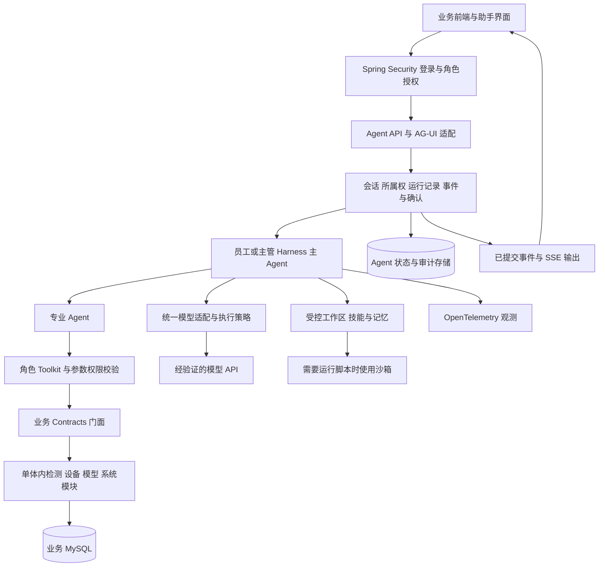

**项目 Agent 架构设计方案**

2026-10-13 Agent 报告更新：两类角色增加报告专业 Agent，支持授权查询、本人草稿创建/编辑、运行来源和审计轨迹关联；审批与导出仍走业务页面。实现及 Eval v2 边界见 [Agent 报告工具接入](docs/Agent报告工具接入.md)。

2026-10-13 报告流程更新：私人草稿、冻结提交、独立主管预览确认、审批/驳回、历史修订和审计导出已实现，见 [报告草稿与独立审批](docs/报告草稿与独立审批.md)。本轮没有 Agent 自动审批、会签或公共发布；outbox 事件投递仍待开发。

2026-10-13 组织身份更新：账号、员工与部门稳定 ID 关联、主管管理页面、员工本人身份、版本与事务审计已实现，见 [账号员工部门关联](docs/账号员工部门关联.md)。部门数据权限、动态 RBAC、独立任务复核申请和任务用户 ID 迁移仍为后续开发。

调研日期：2026-10-12。项目：DoorHandleCatch 集装箱门把手缺陷检测系统。当前实施分支：`java`。

**实施顺序：先完善并验收单体项目，再开展微服务拆分。** 本方案按用户提供的架构图逐块整理；当前阶段所有 Agent 入口、会话管理、角色权限、业务工具和业务模块均运行在一个 Spring Boot 应用中。MySQL、Redis、对象存储等可以作为外部基础设施使用，但不因此拆出独立业务服务。

文中“官方能力”表示在官方文档或源码中查到的能力；“当前实现”表示当前 `java` 分支实际存在的代码；“建议方案”表示后续拟实施的设计。配置项、架构图和设计文档不能作为功能已经实现的证据。本方案包含目标设计与已实施部分；以下状态已更新到主站 AgentScope 迁移，未标记为已实现的内容仍需开发和验收。

**一、调研基线与关键判断**

初次调研基线为 AgentScope Java `2.0.1`；模型管理实现已统一升级为 `2.0.4`，以复用原生 Responses 适配器。以下早期版本资料作为设计参考，具体实现以当前锁定版本和验证结果为准。调研时官方最新稳定 Release 为 `v2.0.4`，发布于 2026-10-08；是否升级需要单独验证接口、模型、持久化格式和测试兼容性，不能直接以最新版在线示例替换现有代码。[项目版本配置](D:/AI/lunwen1/DoorHandleCatch/pom.xml:34)、[官方 v2.0.4 Release](https://github.com/agentscope-ai/agentscope-java/releases/tag/v2.0.4)。

官方采用两层设计：`ReActAgent` 提供推理、工具调用、权限和中间件；`HarnessAgent` 在其上组合工作区、记忆、会话、技能、子 Agent 与沙箱。工程能力按需配置，不需要重写推理循环。[Java 2.0.1 Harness 架构](https://github.com/agentscope-ai/agentscope-java/blob/v2.0.1/docs/v2/en/docs/harness/architecture.md)。

AgentScope Service 是可以自托管的独立服务平台，与在 Spring Boot 中嵌入 Harness SDK 是两种交付方式。调研时 Service 首页标注 `2.1.0-BETA1`，部分页面明确标注 preview。当前单体项目优先嵌入 SDK；Service 平台作为后续评估项，不列为本阶段运行前提。[官方 Service 说明](https://java.agentscope.io/v2/en/service/index)、[Service 访问控制预览文档](https://java.agentscope.io/v2/en/service/access)。

在线文档会随开发演进。例如当前文档已介绍 Session Log、`AgentSession` 和后台任务操作；`v2.0.1` 的持久化基线是 `AgentStateStore`。编写实现时应以选定版本的源码和编译结果为准，不能把这些新版 API 默认为 `2.0.1` 已提供。[2.0.1 状态设计](https://github.com/agentscope-ai/agentscope-java/blob/v2.0.1/docs/v2/en/docs/building-blocks/context.md)、[当前会话操作文档](https://java.agentscope.io/v2/en/docs/harness/session-log)。

图中的 EventBridge、MySQL、Redis、OSS、Milvus、Mem0、ReMe、Higress、Nacos、LoongSuite、Langfuse 都有独立职责，需要选择、部署并连接。不能将整张图理解为引入一个依赖即可启用的完整应用。

**二、当前单体项目的实际状态**

| 范围             | 已核对的事实                                                                                        | 对本次开发的影响                           |
| ---------------- | --------------------------------------------------------------------------------------------------- | ------------------------------------------ |
| 应用装配         | `doorhandle-server` 同时依赖 `doorhandle-module-app` 和 `doorhandle-module-ai`                | 同进程装配会话适配与 AgentScope 引擎   |
| 主站助手         | 主 Vue 保留 `/api/chat-assistant/**` 协议，现已转接 AgentScope；旧编排与客户端已删除                        | 保留用户会话与 UI，全部 Agent 在 AI 模块实现   |
| 新助手           | `frontend-agent` 为 React 前端，调用 `/agui/catalog`、`/agui/run`                             | 与主站使用同一工厂、模型服务与角色工具           |
| 角色入口         | 员工与主管主 Agent 由登录身份选择，专业 Agent 仅允许内部委派                                        | 沿用服务端身份绑定，不接受模型自报角色     |
| 主 Agent         | 使用`HarnessAgent`，每轮创建实例                                                                  | 保持请求隔离，补充可靠的共享状态后端       |
| 专业 Agent       | 通过自定义委派工具创建`ReActAgent`                                                                | 当前不是已启用的 Harness 原生子 Agent 管理 |
| 业务工具         | contracts 门面查询检测、设备和模型；主管可提出质检分配并经独立页面确认提交                              | 已有一项写操作闭环，其他写工具待开发       |
| 数据边界         | 员工读取本人及分派任务，主管为单企业范围；账号可关联员工及部门 ID                                        | 部门数据权限、企业租户与任务用户 ID 迁移待开发 |
| 会话             | 主站历史由 MySQL 恢复；AG-UI 历史仍由前端提交，SDK 状态临时保存                                                                        | 主站文本可延续；SDK 断点和工具状态不能恢复       |
| 并发             | 两个入口共享 AgentRunRegistry；开启数据库日志时增加会话互斥、重复运行拒绝和租约                          | 历史轨迹可恢复读取，SDK 执行不自动续跑     |
| Harness 工程能力 | 工厂显式关闭持久会话、记忆钩子、压缩、工具结果卸载、文件与 Shell 工具、动态 Skills、原生子 Agent 等 | 应逐项补齐配置、权限、存储和验收后再启用   |
| A2UI             | 现有渲染器仅识别自定义`v1.0` envelope 中的 Text、Column                                           | 属于有限组件实现，不能声称完整协议兼容     |
| 外部集成         | 多组环境配置属于预留契约                                                                            | 不将开关存在视为连接器已实现               |

依据：[服务模块装配](D:/AI/lunwen1/DoorHandleCatch/doorhandle-server/pom.xml)、[旧助手 Controller](D:/AI/lunwen1/DoorHandleCatch/doorhandle-module-app/src/main/java/com/ruanzhu/doorhandle/module/app/controller/ChatAssistantController.java)、[新助手 Controller](D:/AI/lunwen1/DoorHandleCatch/doorhandle-module-ai/src/main/java/com/ruanzhu/doorhandle/module/ai/api/RoleAgentController.java)、[Agent 工厂](D:/AI/lunwen1/DoorHandleCatch/doorhandle-module-ai/src/main/java/com/ruanzhu/doorhandle/module/ai/agent/RoleAgentFactory.java)、[A2UI 渲染器](D:/AI/lunwen1/DoorHandleCatch/frontend-agent/src/A2uiSurface.jsx)、[已实现范围与限制](D:/AI/lunwen1/DoorHandleCatch/docs/agent-role-toolkit-progress.md)、[平台配置说明](D:/AI/lunwen1/DoorHandleCatch/docs/agentscope-platform-config.md)。

**三、单体阶段的目标架构**

下图为目标设计，不代表当前全部实现。保留现有 Spring Boot 模块结构与 Vue 业务页面，统一 Agent 执行入口；是否继续保留独立 React 助手页面，应在统一会话与协议后决定。

Agent Service 在本阶段是单体内的应用服务层，可以拆成会话、运行、确认、事件和工作区管理组件；不要求创建新的可执行服务或修改部署为微服务。业务鉴权仍以现有用户体系为基础。

**四、多端接入层逐块设计**

| 图中模块        | 官方设计与能力边界                                                                                            | 单体项目建议方案                                                                                                                                  | 验收条件                                                                   |
| --------------- | ------------------------------------------------------------------------------------------------------------- | ------------------------------------------------------------------------------------------------------------------------------------------------- | -------------------------------------------------------------------------- |
| A2A：Agent 协作 | Java 提供独立 A2A client/server 扩展，利用 AgentCard 描述并发现远程 Agent                                     | 同进程专业协作使用本地委派；确有外部 Agent 互通需求时再接 A2A，单独校验调用者与业务权限                                                           | 未授权外部调用被拒绝；本地功能不依赖远程 A2A 服务                          |
| A2UI：UI 生成   | 描述组件、数据绑定与用户动作；客户端使用组件目录渲染，属于界面描述协议                                        | 先固定协议版本与组件目录，支持任务卡片、统计卡片及确认卡片；通过明确的自定义事件传输。拒绝任意 HTML、脚本、未登记组件、循环组件引用和越界数据路径 | 官方 Schema 或选定子集校验通过；非法描述安全降级；按钮动作再次接受后端鉴权 |
| AG-UI：人机交互 | Java 扩展将 Agent 事件映射为文本、工具调用、状态和运行事件，可通过 SSE 输出                                   | 统一主前端与 React 助手的事件契约；身份、Agent 选择和会话所属权由后端控制。记录事件再输出，支持后续按游标补读                                     | 文本分块顺序正确；成功/失败只产生对应终态；断线恢复不重复执行任务          |
| Responses API   | Python AgentScope Runtime 文档提供 Responses 兼容的 Agent 服务入口；这与模型供应商的 Responses 接口是不同方向 | 当前首先完成 AG-UI。需要兼容外部 Responses 客户端时，评估 Java 对应版本能力或单独适配；不能仅靠`AGENT_RESPONSES_*` 配置宣称已实现               | 明确对外 Agent 接口与内部模型接口；通过客户端契约测试后才发布兼容声明      |

来源：[Java A2A 扩展](https://java.agentscope.io/v2/en/integration/protocol/a2a)、[A2UI 官方协议说明](https://a2ui.org/)、[Java AG-UI 扩展](https://java.agentscope.io/v2/en/integration/protocol/agui)、[Python Runtime 兼容入口](https://github.com/agentscope-ai/agentscope-runtime/blob/main/cookbook/en/call.md)。调研时 A2UI 官网将 `0.9.1` 标为当前版本、`1.0` 标为候选版本；项目现有 `v1.0` 字段不能直接视作完整候选规范实现。

**五、前端 / UI 层：Spark Design**

Spark Design 是独立的组件与聊天体验库。官方仓库提供 `@agentscope-ai/design` 和 `@agentscope-ai/chat`，底层使用 Ant Design；仓库说明 design 包使用 MIT、chat 包使用 Apache-2.0，应按实际采用包保留相应许可证声明。[Spark Design 官方仓库](https://github.com/agentscope-ai/agentscope-spark-design)。

建议沿用现有 Vue 业务页面和组件风格，先使其调用同一 Agent 后端。现有 React 助手可复用已安装的 Spark 组件，不为更换 UI 库重写全部业务页面。统一会话列表、历史、流式回复、工具状态、取消、重试与确认状态；仅展示操作步骤、证据和执行进度，不要求返回模型内部思维过程。

视觉遵循白色为主、黑蓝辅助；使用开源图标；动画用于状态反馈，兼容减少动态效果设置。验收重点是登录一致、同一会话历史一致、流式响应稳定、确认结果可追溯和移动端可操作。

**六、Agent Service：智能体服务层**

官方 Service 提供托管运行、资源配置、会话、权限及自动化能力；嵌入 SDK 的应用仍需实现自己的 HTTP、业务身份和运行管理。以下组件是本项目的单体内设计，不直接照搬预发布平台的全部接口。

| 图中模块                            | 建议设计                                                                                                                     | 持久化与边界                                                                                | 验收条件                                                                             |
| ----------------------------------- | ---------------------------------------------------------------------------------------------------------------------------- | ------------------------------------------------------------------------------------------- | ------------------------------------------------------------------------------------ |
| Background Task Management          | 将长时间报告、批量分析建模为后台运行，记录排队、运行、等待输入、完成、失败、取消等状态；限制线程池、队列、执行时长与模型预算 | 接受任务先持久化，再执行。普通短聊天可保持请求内流式执行；后台任务不能随 SSE 连接断开而丢失 | 页面关闭后可查询任务；取消有效；重启后可识别未完成运行并按所选版本能力恢复或标记中断 |
| Session Management                  | 管理会话创建、标题、归档、历史、所属用户、Agent 类型及运行编号；前端提交新输入，历史由服务端加载                             | `userId` 来自登录态；检查 session 所属权。稳定会话身份用于访问共享状态后端                | 用户不能读写他人会话；刷新、重启后已完成历史可恢复；同会话并发被串行化或明确拒绝     |
| User Authentication & Authorization | 复用 Spring Security、JWT / HttpOnly Cookie；验证角色入口、工具注册权限、资源数据权限和会话权限                              | 模型参数不得覆盖用户、角色、部门。工具业务门面仍执行最终授权                                | 员工伪造角色、会话 ID、资源 ID 均不能获得主管或他人数据                              |
| Cron Job Management                 | 优先选官方 Quartz 或 XXL-Job 调度扩展中的一种；日报等任务绑定明确的系统身份与范围                                            | 保存调度规则、时区、启停与运行结果；在执行时再次验证权限，限制任务重叠                      | 时区正确；同次触发不重复创建任务；暂停与失败结果可查询                               |
| Storage / DB Management             | 管理会话元数据、执行记录、工具审计、确认操作以及 SDK 状态后端                                                                | 业务表与 Agent 表明确分工；保留旧历史迁移策略，不让 SDK 自动建表替代项目数据库迁移          | 表版本可追溯；敏感信息脱敏；历史与状态可备份恢复                                     |
| Workspace Pool                      | 管理静态模板、用户运行目录、容量、租约、清理及沙箱映射，作为应用资源管理组件                                                 | 文件按角色、用户和会话隔离；配置与个人运行内容分开；不把当前进程工作目录当通用执行区        | 目录越界被拒绝；用户目录互不可见；资源释放和保留策略有效                             |

来源：[SDK 与 Service 责任边界](https://java.agentscope.io/v2/en/service/index)、[调度扩展](https://java.agentscope.io/v2/en/integration/infrastructure/scheduler)、[Service 自动化预览](https://java.agentscope.io/v2/en/service/automation)。Service 的调度与资源管理接口属于平台产品能力，不能直接认定当前 SDK 已经替项目完成这些管理功能。

**七、Event System：事件系统**

| 图中模块          | AgentScope 设计                                                           | 本项目方案                                                                                                                    |
| ----------------- | ------------------------------------------------------------------------- | ----------------------------------------------------------------------------------------------------------------------------- |
| Message & Event   | `Msg` / ContentBlock 表达完整消息及工具结果，Event 表达执行中的增量变化 | 区分用户消息、助手消息、工具输入、工具结果和执行事件；保留关联 ID。模型输出与业务证据分别保存，便于核对                       |
| Event Streaming   | 从 Agent 事件流适配 AG-UI 等传输协议                                      | 统一事件 envelope，至少关联 session、run、工具调用和 trace。持久化事件序号，客户端去重；流式发送失败与 Agent 任务失败分别处理 |
| Human-in-the-Loop | 权限系统可暂停待确认工具，并通过确认结果继续执行                          | 后端保存待确认操作、参数摘要、有效期、资源版本和请求者。前端提交确认 ID 与决策，不能用客户端提供的工具结果冒充已执行结果      |

来源：[Message &amp; Event](https://java.agentscope.io/v2/en/docs/building-blocks/message-and-event)、[2.0.1 Permission System](https://github.com/agentscope-ai/agentscope-java/blob/v2.0.1/docs/v2/en/docs/building-blocks/permission-system.md)。

建议事件字段为 `eventId`、`sequence`、`sessionId`、`runId`、`type`、`timestamp`、`traceId`、`payload`；这是项目外层 envelope 的设计，不应无验证地改动 AG-UI 标准事件结构。可通过自定义字段或独立事件存储关联标准事件。

验收应覆盖：事件有序、失败终态、浏览器断线、重复订阅、等待确认、拒绝确认、过期确认、取消运行，以及用户刷新页面后只读恢复历史而不重新触发模型或业务工具。

**八、Agent Engine：智能体引擎**

| 图中模块          | AgentScope 设计                                                | 本项目方案                                                                                                               | 验收条件                                                             |
| ----------------- | -------------------------------------------------------------- | ------------------------------------------------------------------------------------------------------------------------ | -------------------------------------------------------------------- |
| Reasoning         | ReAct 推理—工具—结果循环；Harness 复用该内核                 | 主 Agent 根据问题委派专业查询并汇总证据；缺失参数追问，业务规则和指标计算落在确定性代码中                                | 无工具证据时不编造业务事实；轮数、超时和 token 预算均受约束          |
| Batch Acting      | 同轮可能产生多个工具调用；工具契约包含只读与并发安全声明       | 独立只读查询可有限并发；同一资源的写操作按业务事务与版本控制执行。批量操作限制数量，返回逐项结果                         | 并发不串用户身份；批量部分失败可解释；写请求不能靠重试重复生效       |
| Permission System | 工具调用决策包括 ALLOW、DENY、ASK，可配置规则和运行时检查      | 查询满足角色与数据范围后自动允许；写操作按业务等级进入确认；模型发布等高影响操作保留业务审批。自然语言提示不作为授权机制 | 未授权工具不会执行；用户确认也不能扩大其业务权限；取消确认不产生写入 |
| Toolkit           | Java 方法工具、显式 AgentTool、MCP 工具通过 Toolkit 注册和调度 | 沿用角色专用 Toolkit 与 contracts 门面。每次执行绑定不可变身份，限制 JSON Schema、参数、分页和返回字段                   | 工具参数不能指定他人身份；返回信息不泄漏路径、密钥或内部对象         |

来源：[2.0.1 ReAct / Harness 关系](https://github.com/agentscope-ai/agentscope-java/blob/v2.0.1/docs/v2/en/docs/harness/architecture.md)、[Tool 契约](https://java.agentscope.io/v2/en/docs/building-blocks/tool)、[Permission System](https://java.agentscope.io/v2/en/docs/building-blocks/permission-system)。

业务职责建议保持为两套角色能力目录：员工面向本人检测任务、质检记录、授权设备信息与个人统计；主管面向授权范围的检测质量、资源管理、模型运维与统计。当前未建立部门关联前，主管范围必须继续标注单企业；不能将 `department-analytics` 名称当作部门隔离已经实现的证据。

先完善现有本地专业委派和审计，再评估 Harness 原生子 Agent。同步委派用于短查询，后台委派用于长报告；子 Agent 权限必须为主 Agent 已授权能力的子集。当前自定义委派与原生子 Agent 不能同时无约束开放，避免产生两套任务管理。[官方子 Agent 设计](https://java.agentscope.io/v2/en/docs/harness/subagent)。

**九、Workspace：工作区与执行环境**

| 图中模块          | 官方机制                                                                  | 单体方案与适用场景                                                                                          | 验收条件                                                                 |
| ----------------- | ------------------------------------------------------------------------- | ----------------------------------------------------------------------------------------------------------- | ------------------------------------------------------------------------ |
| Local File System | 工作区保存 Agent 定义、知识、技能、记忆及运行文件；本地文件系统是一种后端 | 开发阶段使用 D 盘项目专用运行目录。静态定义版本化；用户运行文件与源码隔离。首先只开放实际需要的受控文件能力 | 路径经过规范化和边界校验；不跨用户；重启后状态文件仍可读取               |
| Docker            | Docker 文件系统 / 沙箱扩展承载隔离执行，支持生命周期和快照配置            | 有报告脚本、文件转换或分析代码需求时启用；只读业务查询继续走 Java 门面。限制挂载、网络、资源及凭证          | 脚本只在指定容器运行；没有宿主源码、Docker socket 或生产凭证的非必要访问 |
| Cloud Sandbox     | 对接远程沙箱服务；配置具体供应商和恢复后端                                | 作为后续可选执行位置，不作为单体聊天的必需依赖；按供应商验证文件传入、产物取回、预算与清理                  | 故障与超时可诊断；容器或会话释放；实际产物可取回并核验                   |

来源：[工作区](https://java.agentscope.io/v2/en/docs/harness/workspace)、[文件系统](https://java.agentscope.io/v2/en/docs/harness/filesystem)、[沙箱](https://java.agentscope.io/v2/en/docs/harness/sandbox)。

本项目建议运行目录为 `D:/AI/lunwen1/DoorHandleCatch/work/agent-runtime/`，并加入运行目录忽略规则。还需检查 SDK 的状态目录，不能只设置 workspace 就假定状态也在 D 盘；`2.0.1` 默认本地状态可能位于用户家目录，可通过该版本支持的状态后端或 `agentscope.state.home` 指定。[2.0.1 状态存储说明](https://github.com/agentscope-ai/agentscope-java/blob/v2.0.1/docs/v2/en/docs/building-blocks/context.md)。

建议静态目录包含 `AGENTS.md`、`knowledge/`、`skills/`、`subagents/` 与工具配置；运行目录包含用户、会话、产物和记忆。目录名只是项目组织建议，最终通过 WorkspaceManager 映射，不绕过 SDK 文件系统直接写宿主文件。

**十、Model：模型管理与模型接入层**

| 图中模块                       | 已核实的框架设计                                                                                  | 本项目建议                                                                                                                    |
| ------------------------------ | ------------------------------------------------------------------------------------------------- | ----------------------------------------------------------------------------------------------------------------------------- |
| Chat Model                     | Model / Formatter / ModelRegistry 与供应商扩展分离，可用模型 ID 或显式 builder 构建               | 一个集中配置入口，显式区分供应商、模型名、协议、endpoint、生成参数与凭证；主 Agent、专业 Agent 和摘要任务采用可追溯的模型策略 |
| Retries                        | `2.0.1` 的 ExecutionConfig 定义超时、最大尝试次数、退避与可重试错误                             | 避免网关、SDK 与应用重复重试；仅重试允许的暂时错误；限制总时长。模型重试与业务工具写入重试分别设计                            |
| Fallback                       | 官方 codingagent 示例存在 FallbackModel 装饰器；不代表应用配置一个 fallback-provider 就自动生效   | 按模型兼容性与错误类型显式配置备用模型；记录实际使用模型。认证错误、非法参数和业务授权失败不盲目切换                          |
| TTS / Realtime                 | 各语言、供应商和版本的实现范围不同，不能仅根据架构图推断统一能力                                  | 当前优先文本与现有语音转写；需要播报时单独验证 TTS，需要实时语音时再验证供应商会话接口、鉴权与流式音频链路                    |
| DeepSeek / GLM / OpenAI / Qwen | Java 提供供应商扩展；OpenAI-compatible 接口使用匹配的模型适配和 Formatter，DashScope 另有专用扩展 | 根据实际 HTTP 协议选择适配器，而非只按模型名称选择；记录 endpoint 与兼容性测试结果。全部调用归入同一模型层                    |

来源：[2.0.1 Model 设计](https://github.com/agentscope-ai/agentscope-java/blob/v2.0.1/docs/v2/en/docs/building-blocks/model.md)、[ExecutionConfig 源码](https://github.com/agentscope-ai/agentscope-java/blob/v2.0.1/agentscope-core/src/main/java/io/agentscope/core/model/ExecutionConfig.java)、[FallbackModel 官方示例](https://github.com/agentscope-ai/agentscope-java/blob/v2.0.1/agentscope-examples/agents/agentscope-codingagent/src/main/java/io/agentscope/harness/coding/model/FallbackModel.java)、[OpenAI-compatible 模型集成](https://java.agentscope.io/v2/en/integration/model/openai)、[DashScope 集成](https://java.agentscope.io/v2/en/integration/model/dashscope)。

2026-10-12 模型管理实现更新：DashScope 使用独立 `DASHSCOPE_MODEL=kimi-k3`；DeepSeek 使用 `DEEPSEEK_MODEL=deepseek-flash`；灵算使用 `OPENAI_MODEL=gpt-6.1-sol`。默认角色 Agent 选择 `AGENTSCOPE_AI_MODEL=openai-official:gpt-6.1-sol`。三家凭证和端点由 Spring Environment 分别绑定，主 Agent 与专业 Agent 共用一次执行中已选定的模型。

主站与 AG-UI 角色助手均已使用统一模型服务，支持 DashScope-compatible Chat Completions、DeepSeek Formatter 和原生 Responses。旧 DeepSeekClient、StateGraph 和专业服务已删除；主站保留会话与 SSE 适配，RAG 也通过 AgentScope 生成检索文本。

灵算 Responses 端点为 `https://lingsuan.top/v1`，默认 `gpt-6.1-sol`，绑定用户提供的请求头并发送 `store=false`。已实现模型注册校验、输出预算、首段内容和总执行超时、可选代理、多级备用及进程内熔断恢复；本地已开启 `gpt-6.1-sol → deepseek-flash → kimi-k3`。网络、限流、服务端故障、凭证失败、明确的余额不足错误可在输出前切换；参数错误及部分输出后不切换，不重放工具。登录后的 `/agui/models` 返回脱敏配置、备用顺序与健康状态，助手页面展示默认模型及冷却情况。详细参数与验证记录见 [平台配置说明](D:/AI/lunwen1/DoorHandleCatch/docs/agentscope-platform-config.md)。

验收至少覆盖普通问答、工具调用、流式输出、限流、超时、凭证失败、备用模型策略与最终模型记录。不能用模拟测试代替真实模型联调，也不在未经明确安排时消耗大量模型额度进行批量评测。

**十一、Context Management：上下文管理**

| 图中模块               | 官方机制                                                               | 本项目设计                                                                                                                     | 验收条件                                                         |
| ---------------------- | ---------------------------------------------------------------------- | ------------------------------------------------------------------------------------------------------------------------------ | ---------------------------------------------------------------- |
| Structured Compression | `2.0.1` 提供上下文压缩配置，将较早对话归纳为结构化摘要并保留近期内容 | 摘要保留当前目标、角色范围、任务编号、已验证事实、未完成事项和待确认动作。业务状态与确认记录保存在结构化存储中，不依赖摘要保存 | 长对话仍保留关键引用；摘要不改变权限；任务状态不会因压缩消失     |
| Context Offload        | 大工具结果可写入工作区，并在上下文中保留预览和读取指针                 | 优先业务分页、字段裁剪和定向检索。确需卸载时，文件按用户/会话隔离、限制大小和保留期；同时提供受控读取路径                      | 指针可读取且不可越权；完整证据可查；卸载失败不会生成无效成功引用 |

来源：[2.0.1 上下文压缩](https://github.com/agentscope-ai/agentscope-java/blob/v2.0.1/docs/v2/en/docs/harness/compaction.md)、[当前上下文管理设计](https://java.agentscope.io/v2/en/docs/harness/context)。

会话历史、模型工作上下文、业务状态和长期记忆是四种不同数据。压缩工作上下文不应删除完整审计历史；模型摘要不能替代数据库中的质检结论或审批结果。2026-10-16 已补可选的主 Agent 运行内结构化摘要压缩，复用 2.0.4 原生切点，增加校验、失败回退与轨迹；默认关闭，文件卸载仍未开放，见 [上下文压缩](docs/Agent长对话上下文压缩.md)。

**十二、Agent Middleware：智能体中间件**

`2.0.1` 文档列出 `onAgent`、`onReasoning`、`onActing`、`onModelCall` 与 `onSystemPrompt` 五个扩展位置；当前在线文档额外介绍 `onAgentStateReady`。本项目按锁定版本的真实方法签名实现。[2.0.1 Middleware](https://github.com/agentscope-ai/agentscope-java/blob/v2.0.1/docs/v2/en/docs/building-blocks/middleware.md)、[当前 Middleware](https://java.agentscope.io/v2/en/docs/building-blocks/middleware)。

| 图中模块      | 对应位置               | 本项目设计                                                                                             |
| ------------- | ---------------------- | ------------------------------------------------------------------------------------------------------ |
| Reasoning     | `onReasoning`        | 收集每轮耗时和轮数，限制上下文与执行预算，标注证据来源；不把日志内容当系统指令                         |
| Acting        | `onActing`           | 记录工具名、脱敏参数、授权结果、耗时和结果状态；业务门面仍执行最终数据授权                             |
| Reply         | `onAgent` 外层执行链 | 输出过滤、运行终态、事件关联和结果整理；流式路径也必须遵循相同策略，不等最终回复才检查                 |
| System Prompt | `onSystemPrompt`     | 组合角色职责、统计口径与可信的运行约束。检索文件、用户上传和工具返回内容作为参考材料，不升级为授权规则 |

模型请求超时、成本和用量观测放在 `onModelCall`。身份、角色与数据权限必须由服务端组件确定，不让 Middleware 的提示文本替代 Spring Security 和业务校验。

**十三、数据与存储服务逐块设计**

| 图中模块    | 官方能力或外部职责                                                                  | 单体项目建议                                                                                                                                                      | 验收条件                                                                     |
| ----------- | ----------------------------------------------------------------------------------- | ----------------------------------------------------------------------------------------------------------------------------------------------------------------- | ---------------------------------------------------------------------------- |
| EventBridge | 外部事件路由、重试与死信能力；未将其视为 Java 2.0.1 内置业务事件适配                | 当前保留已有 Kafka 检测链路；先定义检测完成、复核完成、设备告警等业务事件。需要云端事件路由时再增加 EventBridge 适配。内部 Agent token 事件不逐个写入业务消息总线 | 业务事件有 ID、来源、版本；重复投递不重复产生副作用；失败可追踪和补偿        |
| MySQL       | Java 2.0.1 有 MysqlAgentStateStore / MysqlDistributedStore；业务 SQL 数据由应用管理 | 优先复用现有 MySQL，独立组织 Agent 元数据、审计和状态表。清晰区分 SDK 状态快照与产品历史记录                                                                      | 已完成会话可跨重启恢复；表迁移受控；查询与授权正确                           |
| Redis       | Java 提供 Redis 状态后端和分布式存储相关能力                                        | 用于限流、运行租约、幂等热点和需要时的共享状态；不能将无持久化缓存作为唯一审计来源                                                                                | TTL、续租、故障行为明确；同会话并发不覆盖状态                                |
| OSS         | 对象存储承载文件、产物与沙箱快照；Java 有相应存储扩展                               | 存图片、报告、附件及快照，数据库记录元数据；下载按授权生成短期访问凭证。并发控制交给数据库或 Redis                                                                | 文件可关联任务；URL 不跨用户授权；对象生命周期与删除策略可验证               |
| Milvus      | Simple RAG 扩展包含 MilvusStore；需要配套 embedding 与检索流水线                    | 先梳理现有 Chroma RAG，确定是否确需迁移。需要时设计文档版本、片段、来源、访问范围和向量维度                                                                       | 文档检索有来源；索引权限过滤有效；索引不替代实时业务数据库                   |
| Mem0        | Java 有 Mem0LongTermMemory 扩展，对接外部记忆服务                                   | 用于跨会话偏好及可保留事实；本人、角色和业务范围显式绑定。默认不记录凭证、临时授权和全部业务明细                                                                  | 可查询、删除、失效；不能读取他人记忆；事实与业务实时数据冲突时以授权查询为准 |
| ReMe        | Java 有 ReMeLongTermMemory，面向轨迹记忆提取和工作区隔离                            | 作为经验提炼的可选后端；与 Mem0 / Harness 内置记忆分别评估，初期不同时写多套记忆。转成共享 Skill 前需验证和审核                                                   | 经验有来源与适用范围；失败轨迹不会自动形成可信业务规则                       |

来源：[EventBridge 重试与死信](https://www.alibabacloud.com/help/en/eventbridge/user-guide/retry-and-dead-letter)、[事件 ID 与去重约定](https://www.alibabacloud.com/help/en/eventbridge/user-guide/event-overview)、[2.0.1 生产存储选型](https://github.com/agentscope-ai/agentscope-java/blob/v2.0.1/docs/v2/en/docs/others/going-to-production.md)、[OSS 分布式存储](https://java.agentscope.io/v2/en/integration/distributed/oss)、[Simple RAG 与 Milvus](https://java.agentscope.io/v2/en/integration/rag/simple)、[Mem0](https://java.agentscope.io/v2/en/integration/memory/mem0)、[ReMe](https://java.agentscope.io/v2/en/integration/memory/reme)。

建议初始组合为“现有 MySQL + 受控工作区 + 现有业务 Kafka + 按需要接 Redis”。对象存储、向量数据库与记忆服务按已验证场景增加，不同时部署图上所有产品。OSS 不提供分布式执行锁；存储快照存在也不意味着正在进行的外部业务操作可以安全重放。

**十四、长期记忆与 Skills 补充设计**

Harness 内置记忆以日记和整理后的 `MEMORY.md` 分层；压缩摘要与长期记忆提取是不同机制。`2.0.1` 与当前在线文档对记忆注入位置存在变化，应按版本配置并防止记忆内容成为授权依据。[2.0.1 Memory](https://github.com/agentscope-ai/agentscope-java/blob/v2.0.1/docs/v2/en/docs/harness/memory.md)、[当前 Memory](https://java.agentscope.io/v2/en/docs/harness/memory)。

本项目优先定义与检测任务有关的稳定流程 Skill：检测任务查询、质检证据核对、设备异常排查、模型版本比较和统计报告生成。每个 Skill 有明确输入、所需工具、输出证据和适用角色；先由开发维护并版本化，后续再开放经验草稿生成。

官方 Skills 支持工作区及 Git、Nacos、MySQL、classpath 等来源。需要脚本的 Skill 必须经过受控执行环境；读到 Skill 指令不代表获得新的业务权限。共享经验采用草稿、验证、审批、发布和版本回退流程，不直接把用户历史对话变成全局规则。[官方 Skill 设计](https://java.agentscope.io/v2/en/docs/harness/skill)。

验收覆盖：正确选取 Skill、只加载所需内容、引用来源、角色隔离、版本固定、草稿不影响生产，以及启用记忆后的额外模型用量。

**十五、基础设施与可观测性逐块设计**

| 图中模块      | 官方/生态职责                                                                    | 单体阶段设计                                                                                                           |
| ------------- | -------------------------------------------------------------------------------- | ---------------------------------------------------------------------------------------------------------------------- |
| Higress       | AI / API 网关；AgentScope Java 扩展主要用于接入 Higress 发布的 MCP 工具          | 当前保留已有应用入口与反向代理；需要统一模型或 MCP 治理时再引入。网关鉴权不替代业务资源鉴权，透传 SSE 时核对缓冲与超时 |
| Nacos         | AgentCard 发现、Prompt 配置和 Skill 仓库等扩展；普通微服务注册属于另一组集成     | 单体初期用版本化配置和环境变量。确有动态 Prompt / Skill 管理需求再接 Nacos，不因图上出现 Nacos 就创建服务注册依赖      |
| OpenTelemetry | Java Middleware 提供 Agent、模型调用和工具执行的链路埋点；需另配 SDK 与 exporter | 统一 request / session / run / tool / trace 关联，记录耗时、错误和 token 使用；对用户输入、工具数据及凭证脱敏          |
| LoongSuite    | 基于 OpenTelemetry 的自动采集生态，负责埋点与导出；不是独立的日志存储数据库      | 先选择应用显式 Middleware 埋点或合适的自动采集方式，避免重复 span。数据交给 Studio、Langfuse 或其他后端存储分析        |
| Langfuse      | 接收遥测，用于 LLM 调试、追踪与评估                                              | 先连通 OTLP 和身份脱敏，再建立固定问答与工具调用评测。评测数据必须来自有访问权的样本，并记录模型、Prompt 和 Skill 版本 |

来源：[Higress 扩展](https://java.agentscope.io/v2/en/integration/infrastructure/higress)、[Nacos 扩展](https://java.agentscope.io/v2/en/integration/infrastructure/nacos)、[2.0.1 OTel Middleware](https://github.com/agentscope-ai/agentscope-java/blob/v2.0.1/docs/v2/en/docs/building-blocks/middleware.md)、[官方 Studio / LoongSuite 集成说明](https://github.com/agentscope-ai/agentscope-studio/blob/main/docs/tutorial/en/develop/tracing.md)、[Langfuse OpenTelemetry 集成](https://langfuse.com/integrations/native/opentelemetry)。

观测验收包括一次请求可追踪到专业 Agent 与业务工具、失败可定位、实际模型及 token 用量可查，以及日志中不出现 API Key、Cookie、JWT 和非必要业务明细。单独引入 OTel API 并不证明数据已成功导出到观测平台。

**十六、智能体隔离执行环境：Docker / E2B**

Docker 适用于已有容器基础设施上的受控脚本执行；E2B 属于外部沙箱提供方，需对应版本的 Java 扩展及服务凭证。两者解决执行位置与隔离问题，不负责本项目的员工、主管、任务和文件授权。[官方沙箱机制](https://java.agentscope.io/v2/en/docs/harness/sandbox)。

当前只读业务查询不需要 Shell。第一阶段保持禁用；在报告脚本等功能具备明确需求后，再配置沙箱、最小挂载、有限网络、CPU / 内存 / 时长预算、产物出口、快照和清理。不得让 Agent 在 Spring Boot 宿主机上无限制执行命令。

验收需要验证真实执行位置、输出文件归属、无越权挂载、超时终止、资源释放和快照恢复。用户/会话共享沙箱时另外验证并发租约；业务状态恢复、文件快照恢复和外部操作补偿分别处理。

**十七、统一新旧助手的单体改造方案**

目标是保留一个 Agent 执行核心与一个模型调用层，同时保留已有业务体验和历史数据。不能仅以“新增了 HarnessAgent”视为完成替换。

| 步骤                  | 实施内容                                                                                             | 完成标志                                                   |
| --------------------- | ---------------------------------------------------------------------------------------------------- | ---------------------------------------------------------- |
| 1. 建立功能与依赖清单 | 阅读旧会话、历史、项目分组、标题/归档、语音、RAG、确认及状态恢复代码；标记业务复用与旧推理编排职责   | 清楚列出需保留功能、迁移目标、历史格式和测试依据           |
| 2. 明确唯一执行入口   | Agent 执行落在`doorhandle-module-ai`；主前端进入同一角色入口。迁移期旧 HTTP 路径可委托同一应用服务 | 用户入口不会分别调用两套推理编排和两套模型客户端           |
| 3. 补齐服务端会话     | 迁移会话所属权、历史、标题、归档与项目关联；绑定持久状态后端                                         | 页面刷新和服务重启后可恢复已完成会话，历史不依赖客户端自报 |
| 4. 迁移业务能力       | 将授权查询、RAG、语音及需保留操作接到统一应用服务或 Toolkit；逐项比较旧功能                          | 迁移清单逐项通过验收；不误删业务页面依赖                   |
| 5. 接入受控写工具     | 完成确认、授权、幂等、资源版本与审计后，开放创建/重试检测、复核等已确定权限的操作                    | 相同确认不重复写入；资源变更后过期确认被拒绝               |
| 6. 清理旧实现         | 删除已无调用者的旧模型客户端、重复编排和无效配置；迁移后端依赖。共享会话或语音等组件按职责保留或移动 | 引用搜索、编译、定向测试和浏览器验收通过                   |

删除前必须区分“旧 Agent 推理实现”和“仍有价值的会话/业务功能”。不能整体删除 `doorhandle-module-app` 来代替迁移。写工具权限以现有业务规则和补齐后的角色模型为准；模型发布/回滚等存在冲突的权限先明确再实现。

**十八、会话、运行与写操作的数据设计约束**

以下是概念实体，尚未创建对应表；具体表名和字段应在读取现有 MySQL 结构后确定，优先兼容已有会话表。

| 概念          | 需要记录的信息                                                   | 设计约束                                                   |
| ------------- | ---------------------------------------------------------------- | ---------------------------------------------------------- |
| Session       | 所属用户、Agent 类型、标题、归档、创建/更新时间                  | 用户身份来自后端；会话查询与更新均检查所属权               |
| Run           | 会话、请求幂等键、状态、模型、Prompt/Skill 版本、开始/结束及错误 | 同会话执行串行；重复提交返回已有结果或明确冲突             |
| Message       | 内容块、角色、会话、运行与消息编号                               | 原始历史与压缩工作上下文区分；工具结果不混作自然语言回答   |
| Event         | 运行、事件序号、类型、时间与脱敏 payload                         | 有稳定游标；补读不重新执行；保留期与归档可配置             |
| ToolCall      | 工具名、调用 ID、输入摘要、输出摘要、授权结论与耗时              | 保留真实执行结果；脱敏；外部操作结果未知时不得自动标成功   |
| PendingAction | 操作类型、参数摘要、请求者、目标资源版本、确认状态和过期时间     | 确认时再次鉴权；服务端加载待确认参数；不接受客户端任意重写 |
| RuntimeState  | SDK 状态快照、版本/格式、用户与会话命名空间                      | SDK 状态与产品元数据分别负责；升级前验证兼容与备份         |

写操作建议通过“拟执行操作 → 服务端保存 → 用户确认 → 再次授权/版本校验 → 幂等执行 → 记录结果”闭环。审批与 Agent 确认是不同流程：用户确认助手操作不等于绕过主管审批。

`2.0.1` 的状态存储文档说明快照主要在 call 结束时保存。完成会话持久化不等于已具备任意执行点的崩溃续跑。早期实现应清楚标记中断运行并核查可能的业务副作用；若需要任务排队、HITL 持久恢复与事件回放，先评估升级后所选版本的具体能力，再进行故障注入验证。

**十九、单体项目实施阶段与验收门槛**

| 阶段              | 开发目标                                                         | 必须通过的验证                                                 |
| ----------------- | ---------------------------------------------------------------- | -------------------------------------------------------------- |
| A：统一入口与模型 | 主前端接入统一角色 Agent；修正模型协议和 URL；整理旧链路迁移清单 | 登录/角色隔离、旧入口兼容策略、真实模型工具调用及流式展示      |
| B：会话与事件     | 服务端历史、持久状态、运行编号、取消/失败、事件记录和恢复        | 刷新、重启、并发、重复提交、断线，以及他人会话越权测试         |
| C：业务工具与确认 | 补充身份关系和所需只读工具，开放具备授权规则的写工具             | 真实数据库范围校验、参数边界、确认过期、重复确认、资源版本变化 |
| D：知识与长任务   | RAG、Skill、上下文压缩、报告产物；按需求引入记忆与沙箱           | 引用准确、证据可追溯、长会话、脚本隔离、后台任务和产物核验     |
| E：观测与发布     | OTel、错误诊断、固定评测、部署文档、旧实现清理                   | 后端相关测试、前端协议/构建、浏览器端到端、重启恢复与回归清单  |

只读查询、确定性统计和固定页面操作不必全部交给模型处理。Agent 负责理解与协调，业务模块负责可靠操作与数据事实。每阶段完成后记录“已实现、测试替身验证、真实环境验证、仍未完成”，避免把设计目标写成实施结果。

**二十、后续微服务阶段的衔接**

只有单体阶段通过相应业务回归和部署验收后，再进入微服务开发；届时另建工作分支，不在当前 `java` 分支实施拆分。

单体现在应保留可迁移的模块边界：AI 通过 contracts 调业务门面，不直连业务 Mapper；身份与权限上下文由后端绑定；会话、状态和事件有明确归属；业务事件有版本、幂等与 trace；文件访问通过授权接口。

这些边界先用同进程 Java 调用实现。后续再按真实独立扩容和部署需求决定 Agent 服务、检测服务、资源/模型服务等边界，把门面替换为远程客户端。再评估网关、服务发现、服务间身份、超时、故障隔离和各服务数据归属。不要在单体完善过程中提前引入远程 HTTP 依赖或跨库事务来模拟微服务。

此前的微服务改动保存在 Git stash 中，本方案不将其计入单体当前功能。恢复或继续这些改动应在单体验收之后进行。

**二十一、开源、版本与交付说明**

AgentScope Java 官方许可证为 Apache-2.0。Spark Design 的具体包及 A2UI 协议实现具有各自许可证，引用或复制源码时按对应仓库保留声明。外围产品在实际引入前还需核对所选版本的许可证、维护状态、Java 17 / Spring Boot 兼容性和部署要求，不通过本方案一次性批准安装全部组件。[AgentScope Java 许可证](https://github.com/agentscope-ai/agentscope-java/blob/v2.0.1/LICENSE)、[Spark Design 许可说明](https://github.com/agentscope-ai/agentscope-spark-design)、[A2UI 许可与规范](https://a2ui.org/)。

本次已完成架构图各模块的官方资料核对、当前代码差距梳理，以及“单体优先、微服务后置”的设计整理。模型管理代码已升级 SDK 并接入三家模型配置，阶段 A 的统一入口与模型已经落地，阶段 B 已增加持久运行和事件日志；尚未完成SDK 状态持久恢复以及其他阶段完整验收。后续按单体阶段继续实施，并以平台配置文档中的验证记录为准。

**当前迁移边界（2026-10-12）**

主站已提供按会话所有权读取的最新 AgentScope 执行摘要与真实事件页面，保留 MySQL 文本历史。旧待确认动作只能取消，不能恢复执行。该摘要只记录至多 200 条框架事件元数据，不等同于本文规划的持久 Turn/Call 审计、全量子 Agent 轨迹、可恢复人工确认或 Eval 系统。完整迁移说明与验收结果见 [实施进度](docs/agent-role-toolkit-progress.md)。

**阶段 B 实施更新（2026-10-12）**

已新增 AgentScope SDK 中间件、`agent_run` / `agent_run_event` 迁移、两个入口的持久运行终态、主 Agent 与专业业务工具调用关联、按账号所属权读取的历史与事件游标、运行取消、AG-UI 重复请求拒绝，以及租约过期中断标记。主站轨迹页支持历史选择、全部入口、分页补读和完整分页导出。详情见 [运行日志实施说明](docs/agentscope-run-journal.md)。

此实现提供已记录结果的恢复读取，未实现 SDK 任意断点续跑或可靠后台任务；统一 AG-UI 数据库消息历史已在后续会话统一阶段完成。当前本机业务库 `doorhandledb` 已执行 V16 新表迁移并开启 `AGENT_RUN_JOURNAL_ENABLED`，后端健康检查通过。只读查询权限与事件审计已有代码，完整业务审计、写操作确认和 Eval 仍属于后续阶段。

**阶段 C 第一项实施更新（2026-10-13）**

已增加主管质检分配提议、持久人工确认、账号限定的详情与审计查询、过期与失效处理、重复确认保护、资源快照校验和单数据库事务。主站提供确认卡片与操作确认页面，独立 Agent UI 使用同一确认页。SDK 工具只保存提议，确认接口核对已存参数后才调用业务服务；没有开放任意客户端 resume。配置、迁移和验证见 [质检分配与人工确认](docs/agentscope-action-confirmation.md)。其他写工具、完整身份关系、独立审批、全业务审计、Eval 和微服务仍按后续阶段实施。

**多用户范围实施更新（2026-10-13）**

采用用户明确选择的“员工看本人及分派任务、主管看全企业”。检测业务查询、旧记录、统计、Agent 工具和文件权限已统一；私人聊天、记忆、运行日志与确认记录保持所属账号边界。三个账号的真实接口、重新分派后访问撤销和浏览器页面已验收，详情见 [多用户权限与数据范围方案](docs/多用户权限与数据范围方案.md)。部门公共发布仍为后续方案，不扩大现阶段员工数据范围。

**第一版 Eval 实施更新（2026-10-13）**

已按单体方案增加 22 项固定规则用例、评分与完整性门槛、JSON/Markdown 报告和基线比较脚本，复用 SDK 执行链与确认事务。模型与业务门面采用合成 fixture，确认使用隔离 H2；真实模型语义路由、回答质量、提示注入与跨用户负载评测仍待开发。使用范围和验收见 [AgentScope Eval](docs/agentscope-eval.md)。

**业务卡片实施更新（2026-10-13）**

两套前端已接通任务、质检、统计、报告查询与草稿结果卡片；卡片引用来自注册业务工具的实际返回，主站消息持久化，查看及手动刷新重新校验当前角色和对象范围，不重放模型或写操作。AG-UI 使用版本化项目自定义事件，尚非完整 A2UI 标准或统一服务端 AG-UI 消息历史。细节与验收见 [Agent 业务卡片接入](docs/Agent业务卡片接入.md)。

**技能演化实施更新（2026-10-13）**

本人主动授权已完成运行的脱敏工具证据后，可由 Agent 或人工提议私人 Skill 草稿。服务端规则 Eval、主动提交、独立主管业务与隐私审核后按角色发布，经 AgentScope 原生 `load_skill_through_path` 读取；支持加载审计、回退、停用与定期老化。V23 和单体功能开关见 [技能自学习与受控发布](docs/Agent技能自学习与受控发布.md)。此阶段未接入 ReMe、底层模型训练或自动语义质量评测，不开放技能自由改写工具及脚本执行。

**外部资源市场目录（2026-10-13）**

主站新增登录保护的 Agent/MCP/Skill 资源市场入口，收录魔搭、阿里云与腾讯等 11 个平台，区分已核实市场、仅接口和未核实能力。目录提供筛选、官方导航与接入说明；Skill ZIP 上传已移除，外部 Skill 链接下载仍待实现，远程 Agent/MCP、凭证和脚本执行仍待开发。见 [资源市场接入](docs/Agent资源市场接入.md)。

**移除 Skill ZIP 上传（2026-10-13）**

已移除上传界面、multipart API、外部工具映射、ZIP 解析及外部来源创建。新技能继续由授权成功运行提炼，经规则 Eval 和独立审核发布。历史 EXTERNAL_UPLOAD 版本及许可、审计记录保留，只可查看或停用，不可修订、评测、发布、回退启用及原生加载。V24 迁移保留以识别历史来源，不删除既有数据。市场链接自动下载与脚本运行尚未开发。

**单机内网 AI 网关与隔离 MCP（2026-10-15）**

`java-cloud` 保留 Nginx 业务入口，在容器内网接入 Higress 2.2.5。模型继续由 AgentScope Java 2.0.4 工厂接入并保留故障切换；Fetch 经 SDK Streamable HTTP、网关服务认证及运行器签名身份验证后，每次在独立非 root 容器内执行固定 Stdio 服务。用户目录保存注册与版本摘要，运行包和许可证在不可变镜像中；人工确认、按账号启用、工具白名单、运行授权和审计保持在单体。出口代理限制公开网页访问，取消和超时回收容器。当前只是固定 Fetch 的隔离执行，不开放任意脚本或通用沙箱池，见 [实现与服务器部署](deploy/mcp/README.md)。

**本地 Stdio MCP 首个服务（2026-10-13，历史 STDIO 模式）**

Fetch 已实现按账号固定版本下载与依赖锁定、许可保留、隔离 Python 环境、人工安装确认及主动启用。每用户注册与审计在 V25，文件在 users/{userId}/mcp/fetch，主 Agent 使用原生 SDK 协议/工具转换，项目白名单及中间件检查本人启用状态、配置和公开 URL。取消/停用/超时关闭连接；网页及安装提议不会伪装为业务工具学习证据。不是 OS 沙箱或通用 MCP 市场安装器，远程服务、凭证管理、跨实例可靠队列及完整对抗 Eval 后置，见 [本地 Stdio MCP 接入](docs/本地StdioMCP接入.md)。

**Skill 斜杠命令（2026-10-13）**

两套聊天界面已支持 `/` 菜单和按名称或唯一编号明确选择经验技能。后端仅解析本轮用户命令，目录按当前角色提供发布版本；明确调用先核对状态、摘要、来源和规则 Eval，再将经验作为本轮参考交给原 AgentScope Harness。加载有独立审计和脱敏轨迹，菜单补全不执行操作，命令不能新增工具或绕过审批。外部 Skill 下载、安装、卸载和脚本能力仍待开发，见 [Skill 斜杠命令](docs/Agent技能斜杠命令.md)。

## 会话历史与记忆统一实施（2026-10-13）

主站与 AG-UI 已共用服务端 MySQL 会话、历史、RAG 与账号范围 Mem0 记忆，不再采用独立页面传入的历史作为模型上下文。React 可选择和新建会话，刷新恢复文字与业务卡片；不同账号保持私人数据隔离。该阶段完成会话统一，仍未开发 SDK 断点恢复、长上下文压缩和个人记忆治理界面。见 [会话历史与记忆统一](docs/Agent会话历史与记忆统一.md) 及 [开发进展](开发进展.md)。

## 个人长期记忆治理基础（2026-10-13）

已增加本人查看、读取/自动保存设置、删除人工确认、请求去重和无正文审计。账号由服务端身份决定，主管不能管理员工私人记忆。V26 和认证 Mem0 桥接保持原存储，设置由两个聊天入口共用；不向模型注册记忆删除工具。更多分页、编辑、自动过期和真实效果仍待开发，见 [个人长期记忆治理](docs/个人长期记忆治理.md)。
